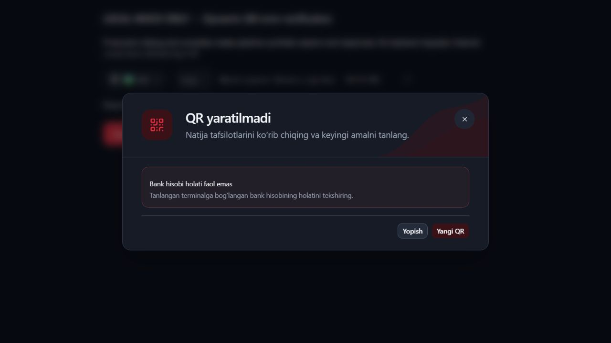
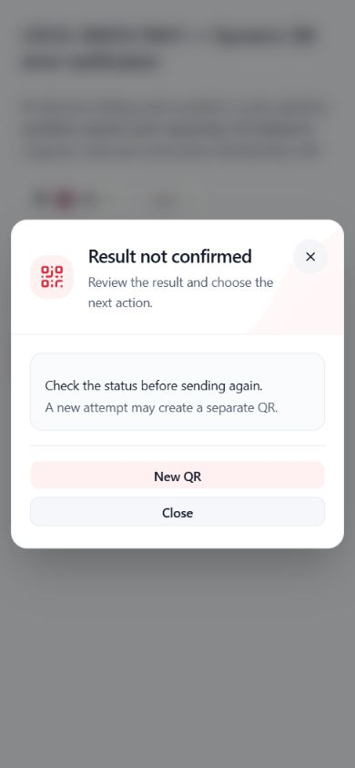

# DYNAMIC_QR.ERROR_PRESENTATION.1 — Business rejection presentation

Status: COMPLETE. Verified locally on 2026-10-15. Browser evidence is explicitly **controlled mock evidence**, not a live staging create response.

## Symptom and root cause

The supplied screenshot showed `Natija tasdiqlanmadi` plus check-before-retry guidance for this response:

```json
{"success":false,"requestId":null,"timeZone":null,"error":{"code":10023,"tag":"BANK_ACCOUNT_STATUS_IS_NOT_ACTIVE","text":"Bank hisobi holati faol emas"},"data":null}
```

The actual flow was:

1. `shared/api/http.ts` preserves HTTP status and the parsed JSON body, including HTTP 200 with success=false. HTTP status alone does not establish success.
2. `live-create-port.ts` returned HTTP 200 bodies, but discarded all non-2xx bodies by throwing a generic HTTP error. Protected session operations normalize failures and intentionally do not expose arbitrary errors to callers.
3. `create-qr.ts` called `decodeCreateQrSuccess`, which immediately called the shared `successEnvelopeData`. That helper accepts only success=true. A valid business rejection therefore became a contract error with no retained symbolic classification.
4. The existing one-dispatch state machine conservatively classified that unproven post-dispatch failure as unknown.
5. `presentCreateResult`, `CreateQrContent` and `CreateQrDialog` faithfully rendered the unknown state, explaining the screenshot. The generic dialog was a downstream symptom, not a translation defect.

## Backend evidence and limits

Read-only source inspection: sibling `D:/QR projects/qrhub-merchant-service`, existing HEAD `894663f7337da1946c21d2003cb19018b128eb55`.

`qh-merchant-web-api/src/main/java/uz/wt/qh/merchant/web/api/service/impl/DynamicQrServiceImpl.java`:

- createDynamicQr starts at line 142.
- line 146 validates the terminal's linked bank account.
- line 152 calls `/partner/transaction-qr/create` only after that validation.
- lines 182–188 load the account and throw `CoreErr.BANK_ACCOUNT_STATUS_IS_NOT_ACTIVE` if its status is not zero.

This specific rejection is raised before the side-effecting core create call and proves that this attempt did not create a QR. The tag/code association 10023 comes from the user-supplied actual response; the shared library enum/exception handler is not defined in this local Web module.

The supplied JSON does not include its HTTP status. No staging creation was made to discover that status. The frontend transport path supports JSON envelopes on HTTP 200 and non-2xx; both were exercised locally. The actual deployed handler's exact status remains unverified. Browser HTTP 422 and test HTTP 400/422/500 are controlled compatibility scenarios, not claims about staging's observed status.

## Minimal implementation

### Central allowlist

New `features/dynamic-qr/create-business-errors.ts` owns the sole approved mapping:

| Primary symbolic tag | Required numeric code | Message key | Guidance key |
| --- | --- | --- | --- |
| BANK_ACCOUNT_STATUS_IS_NOT_ACTIVE | 10023 | create.bankAccountInactive | create.bankAccountInactiveGuidance |

The classifier requires an object envelope, success exactly false, data exactly null, an object error, the exact symbolic tag, numeric code 10023, and nonblank string error.text. Missing/mismatched code, unexpected tag, malformed response, string booleans/codes, nonnull data or invalid text shape do not establish rejection.

Backend text is checked only for shape. It is never used as a translation key, retained as a result reason, displayed or logged. The controller carries only the approved symbolic tag. No other backend error mapping was invented.

### Pipeline and presentation

- `live-create-port.ts`: HTTP 401/403 still enter existing protected session handling first. Other recognized rejection envelopes cross the protected operation as data so normalization cannot erase the classification. Unsupported/malformed responses retain the previous fallback. Successful create still requires the existing HTTP 200 success contract.
- `create-qr.ts`: the feature decoder recognizes the allowlisted failed envelope before calling the unchanged shared success decoder and throws the existing `ActionBusinessRejectionError` with the symbolic tag.
- The existing state machine produces `kind: rejected`; result projection already preserves its safe reason. No shared mutation state-machine changes were necessary.
- `CreateQrResult.tsx`: a known rejected reason resolves catalog-owned error and guidance text. Other rejected reasons keep their existing generic copy.
- `CreateQrDialog` already maps rejected results to its explicit failure heading. No shell, modal sizing, spacing, red accents, actions, theme styles or unrelated dialog redesign was needed.

### Localized copy

| Locale | Message | Guidance |
| --- | --- | --- |
| Uzbek | Bank hisobi holati faol emas | Tanlangan terminalga bog‘langan bank hisobining holatini tekshiring. |
| Russian | Банковский счёт неактивен | Проверьте статус банковского счёта, привязанного к выбранному терминалу. |
| English | The bank account is inactive | Check the status of the bank account linked to the selected terminal. |

The existing failure titles are `QR yaratilmadi`, `QR не создан`, `QR not created`. The unknown title and duplicate-risk guidance are absent for this confirmed rejection. All strings use the existing dynamicQr catalogs; generated key/placeholder metadata was regenerated.

## Outcome categories and lifecycle

| Situation | Result/handling |
| --- | --- |
| Valid exact 10023/tag failed envelope | Confirmed rejected; localized explanation and guidance |
| HTTP 401/403, even with that body | Existing authorization/session processing has priority; never reclassified as business rejection |
| Timeout or connection loss after dispatch | Unknown, with existing check-first and separate-QR risk guidance |
| Malformed/unrecognized/mismatched error or unexpected server response | Existing safe indeterminate fallback; no raw server wording |
| Valid success response | Existing confirmed QR flow, link validation and confirmed-read invalidation |
| Invalid local selection/amount, stale permissions or session | Existing local validation/RBAC/scope safeguards |

The one-dispatch action remains unchanged: pending, confirmed, unknown and rejected attempts cannot be replayed. No catch branch resends the create request. Session refresh is allowed only before dispatch under the existing policy; dispatched auth failures are not replayed.

The form's terminal/amount state and intent snapshot are not cleared by receiving a rejection. The result view temporarily replaces the form. Close retains the closed result/intent under the existing lifecycle. `Yangi QR`/New QR explicitly calls beginNewIntent and clears terminal, amount and submission-feedback state, displaying an empty form. It does **not** submit or retry; a new deliberate submission is required. That behavior is the same for unknown outcomes, whose warning remains visible until the user chooses a separate intent.

Money parsing, terminal bounds, currency rules, request payload, backend contracts, RBAC grants, session implementation and duplicate safeguards were not changed.

## Browser verification — local mock only

Environment: Windows/PowerShell, Node v24.14.0, Vite 8.3.0, React 19, Vitest 5.0.0; existing authenticated app runtime left intact. Existing Vite listeners at 127.0.0.1:5173 and ::1:5173 were detected; no server was started.

Fixture URL: `http://127.0.0.1:5173/docs/audits/evidence/DYNAMIC_QR_ERROR_PRESENTATION/preview.html` in the real Codex In-app Browser.

The fixture imports the actual production `CreateQrDialog`, `CreateQrContent`, live adapter, live port, HTTP transport, session controller, decoder, one-dispatch controller and result component. It supplies a synthetic session and in-memory lookup/error responses. Its fetch implementation never delegates to native fetch, and its CSP blocks external connections. Thus the real UI and classification path are exercised without any backend QR request, real credential or permission change. The fixture is a development artifact outside the production entry graph.

Observed:

- Uzbek, dark desktop: explicit `QR yaratilmadi` heading, exact bank-account message, guidance and existing Yopish/Yangi QR actions. No unknown/duplicate warning.
- Russian, light desktop and 390×844: `QR не создан`, translated explanation/guidance, existing actions. Long text wrapped cleanly; modal bounds x=12…378.4px, height about 382.3px; no page overflow.
- English, dark desktop and 390×844, **mock HTTP 422**: `QR not created`, trusted English explanation/guidance. Correctly classified despite non-2xx status; same geometry and usable vertically stacked mobile actions.
- Uzbek, light 390×844 and 320×568: full text and actions fit. At 320px the modal was 296px wide (x=12…308px), about 405px tall, with no content/page horizontal overflow.
- Mock connection loss, English light 390×844: distinct `Result not confirmed`, `Check the status before sending again.` and `A new attempt may create a separate QR.`
- Mock unrecognized tag: same conservative fallback; `unsafe internal server text` was absent.
- Clicked New QR after both a rejected and an unknown result: form had empty amount and terminal placeholder, with unchanged fixture POST counter. Close/Escape also sent nothing. Six explicit synthetic submissions produced exactly six fixture POST dispatches; final counter screenshot confirms no automatic extra request.
- Language and theme restored to English/dark; viewport override reset.

Responsive browser evidence does not claim physical mobile/touch/software-keyboard or screen-reader audio verification. No real staging create response or deployed handler status was reproduced.

## Regression and quality gates

- New boundary suite: 22 tests through the real HTTP transport → real SessionController → live adapter/port → feature decoder → controller/result. Covers HTTP 200/400/422/500 known rejection, all translations, malicious raw text, timeout/connection loss, malformed/mismatched envelopes, 401/403 priority, retained intent, Close/new-intent and one-dispatch behavior.
- Three additional tests mount the actual dialog/form for uz/ru/en, submit the actual failed envelope through its controller, verify explicit failure title and guidance, absence of unknown warnings, and no automatic send when New QR clears the form.
- Focused Dynamic QR/auth/RBAC/shared-action tests: **514 passed in 59 files** (`npm test -- src/features/dynamic-qr src/shared/api/one-dispatch-action.test.ts src/shared/auth src/features/auth --maxWorkers=2`).
- Full frontend suite: **2,272 passed in 241 files** (`npm test -- --maxWorkers=2`). Existing money/amount, terminal selection, responsive/modal, RBAC, auth/session and i18n regressions passed.
- Typecheck: PASS, including locale validation.
- Lint: PASS; only the existing Button/Badge Fast Refresh export warnings remain.
- Production build: PASS; existing large-chunk advisory remains.
- `git diff --check`: PASS; Git's LF→CRLF advisories do not indicate whitespace errors.

## Changed paths for this checkpoint

Existing unrelated working-tree changes were preserved. Some catalog/generated/i18n-test files also contain earlier checkpoint changes.

```text
src/features/dynamic-qr/create-business-errors.ts
src/features/dynamic-qr/create-business-error-flow.test.tsx
src/features/dynamic-qr/create-qr.ts
src/features/dynamic-qr/live-create-port.ts
src/features/dynamic-qr/CreateQrResult.tsx
src/features/dynamic-qr/dynamic-qr.i18n.test.tsx
src/locales/uz/dynamicQr.json
src/locales/ru/dynamicQr.json
src/locales/en/dynamicQr.json
src/shared/i18n/generated.d.ts
src/shared/i18n/metadata.generated.ts
docs/audits/DYNAMIC_QR_BUSINESS_ERROR_PRESENTATION.md
```

Additional new fixture/screenshot files:

```text
docs/audits/evidence/DYNAMIC_QR_ERROR_PRESENTATION/business-en-dark-http422-390.jpg
docs/audits/evidence/DYNAMIC_QR_ERROR_PRESENTATION/business-en-dark-http422-desktop.jpg
docs/audits/evidence/DYNAMIC_QR_ERROR_PRESENTATION/business-ru-light-390.jpg
docs/audits/evidence/DYNAMIC_QR_ERROR_PRESENTATION/business-ru-light-desktop.jpg
docs/audits/evidence/DYNAMIC_QR_ERROR_PRESENTATION/business-uz-dark-desktop.jpg
docs/audits/evidence/DYNAMIC_QR_ERROR_PRESENTATION/business-uz-light-320.jpg
docs/audits/evidence/DYNAMIC_QR_ERROR_PRESENTATION/business-uz-light-390.jpg
docs/audits/evidence/DYNAMIC_QR_ERROR_PRESENTATION/fixture-final-no-retry-counter.jpg
docs/audits/evidence/DYNAMIC_QR_ERROR_PRESENTATION/preview.html
docs/audits/evidence/DYNAMIC_QR_ERROR_PRESENTATION/preview.tsx
docs/audits/evidence/DYNAMIC_QR_ERROR_PRESENTATION/unknown-en-light-390.jpg
docs/audits/evidence/DYNAMIC_QR_ERROR_PRESENTATION/unrecognized-en-light-390.jpg
```





## Final checkpoint

CHECKPOINT: DYNAMIC_QR.ERROR_PRESENTATION.1

STATUS: COMPLETE

ROOT_CAUSE: Success-only feature decoding erased the known failed envelope; non-2xx port handling also discarded the body, so the existing conservative state machine produced unknown.

BUSINESS_ERROR_10023: HANDLED

BANK_ACCOUNT_INACTIVE_MESSAGE: PASS

CONFIRMED_REJECTION_CLASSIFICATION: PASS

UNKNOWN_OUTCOME_SAFETY: PRESERVED

HTTP_200_SUCCESS_FALSE: PASS

I18N_UZ_RU_EN: PASS

DARK_LIGHT_THEMES: PASS

MOBILE_DIALOG: PASS (responsive viewport evidence; physical mobile not verified)

NO_AUTOMATIC_RETRY: VERIFIED

RBAC_REGRESSION: PASS

TYPECHECK: PASS

LINT: PASS

FOCUSED_TESTS: 514 passed / 59 files

FULL_TEST_SUITE: 2272 passed / 241 files

BUILD: PASS

BACKEND_CHANGED: NO

STAGING_DEPLOYED: NO

REAL_QR_CREATED: NO

FILES_CHANGED: Exact paths listed above, including all new fixture/screenshots.

NEXT_STEP: Review the corrected business-error dialog and audit other known Dynamic QR error mappings.
