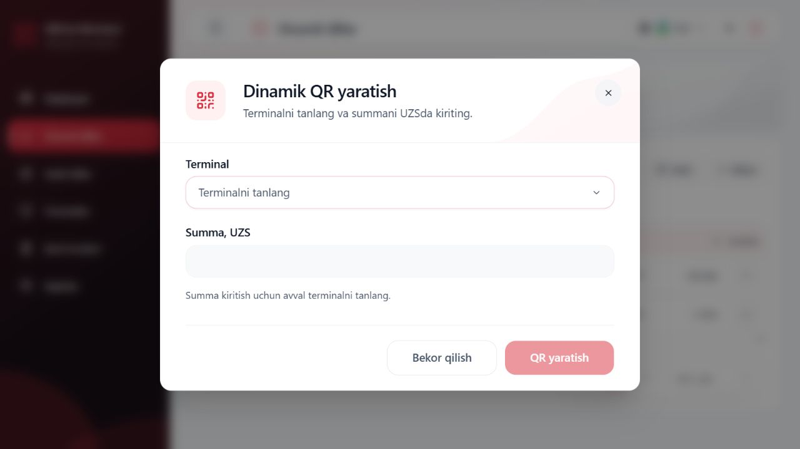
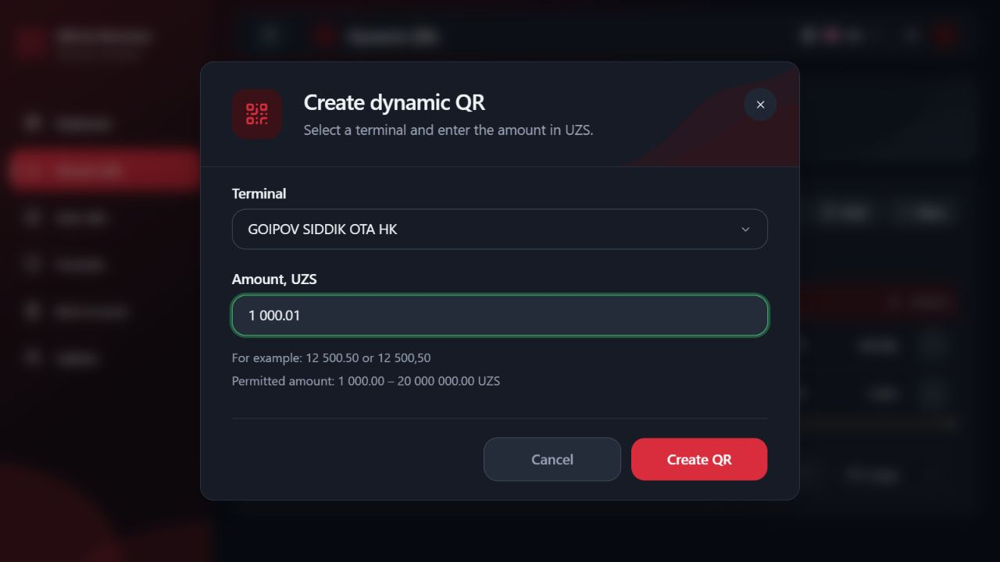

# DYNAMIC_QR.TERMINAL_AMOUNT_GATE.1

Status: COMPLETE. Verified locally on 2026-10-15. No real QR creation or backend data mutation was performed.

## Audit and cause

`CreateQrDialog` mounts the shared `CreateQrContent` for both the modal and route flow. The form already resolves the selected ID against the current create-terminal query and derives canonical bounds through `createAmountBounds`. It had no native disabled prop on `MoneyInput`, so users could focus/type before choosing a terminal; nonempty values could also show an amount error before the prerequisite was satisfied.

`MoneyInput` already forwards native Input props and its real input ref. The shared Input already owns disabled styling/cursor semantics. Select already has an explicit-selection-only close-autofocus callback, with a touch exception. None of these shared components needed changes.

The live create adapter already rechecks session/scope, current terminal/currency snapshots, invalidation, permissions and canonical request validity before dispatch. Its terminal snapshot check did not reject a cached success query while a refetch was running. That meant a direct retained controller call could consult stale cached options even though normal form submission was blocked during fetching.

## Implementation

`CreateQrContent` derives `terminalReady` from existing authoritative values:

- terminal lookup capability and configured transport;
- current create permission;
- successful terminal lookup with fetchStatus=idle;
- selected ID present in those current options;
- a valid intersection of service and terminal amount bounds.

No separately stored validity flag or second terminal source was added. The amount uses native `disabled={!terminalReady}`. The same readiness gates validation visuals, draft edit callbacks, submission and selection-close focus. Submission additionally requires the current amount to pass the unchanged canonical parser and the existing request mapper.

| State | Amount behavior | Feedback / submission |
| --- | --- | --- |
| No selected terminal | Disabled, retained draft | Neutral; translated prerequisite; CTA disabled |
| Initial loading / refetch / paused lookup / error | Disabled | Neutral; existing lookup status/error remains |
| Selected ID removed | Disabled, draft preserved | Existing removed-terminal feedback; CTA disabled |
| Invalid terminal/service bounds | Disabled | Existing bounds feedback; no premature amount error |
| Confirmed terminal + empty amount | Enabled | Neutral until a relevant submit attempt |
| Confirmed terminal + valid amount | Enabled | Existing green border/ring; normal submission validation |
| Confirmed terminal + invalid amount | Enabled | Existing red border/ring and localized error; CTA disabled |

Submit/Enter attempts while the terminal prerequisite is unavailable do not mark the amount as attempted. An attempt with a confirmed terminal retains the existing required-error behavior. Clearing a terminal suppresses amount errors/green styling while keeping the value. Reselecting a confirmed terminal revalidates that value. New intent/close/reopen behavior otherwise follows the existing form lifecycle; only the existing explicit new-intent path clears the draft.

The existing mouse/keyboard close-autofocus callback now requires readiness and an enabled input before preventing the selector's normal restoration. It still places the caret at the preserved amount's end. No timer or render-driven focus effect was added. Loading completion, locale switching and passive query recovery do not steal focus. Touch still returns focus to the terminal trigger and does not force the software keyboard.

`live-create-adapter.getCurrentContext` now also requires the terminal query fetchStatus to be idle. The request mapper and the last check inside the live port use this same current context. Direct controller calls during refetch or after removal therefore produce not-sent without calling the HTTP transport. Existing scope, RBAC, ownership-option, currency and one-dispatch checks remain enforced.

Canonical amount parsing, UZS/tiyin conversion, precision, service limits (100000–2000000000 minor units), terminal-specific bounds, request DTO and endpoint are unchanged.

## Localization and native semantics

Added `create.selectTerminalFirst` to the existing dynamicQr catalogs:

- Uzbek: `Summa kiritish uchun avval terminalni tanlang.`
- Russian: `Сначала выберите терминал, чтобы ввести сумму.`
- English: `Select a terminal before entering an amount.`

Types and metadata were regenerated with `npm run locales:generate`. The existing FormField help ID remains in aria-describedby; disabled/neutral input has no aria-invalid or premature amount-error alert.

Native disabled semantics prevent keyboard focus and user typing. Existing Input styles were reused: opacity 0.5, theme-token disabled background, computed cursor not-allowed and pointer-events none. Because pointer events are disabled, the enclosing noninteractive surface owns actual hit testing; no pointer cursor was added. Shared hover/focus styles and money formatting remain untouched.

## Tests

New/updated DOM and pipeline checks cover:

- initial disabled/neutral state, unfocusability and exact prerequisite helper in uz/ru/en;
- native disabled prop and associated help, without premature amount error;
- terminal loading, clear, cached refetch, removed ID, lookup error and invalid bounds;
- preservation/revalidation against a second terminal with a higher minimum;
- enabled input, explicit keyboard/mouse focus, end caret and touch focus policy;
- empty relevant submit attempt, valid/invalid green/red states, exact minor-unit submission;
- no submission while unavailable, invalid or stale;
- the actual SessionController/live adapter/port path: direct retained controller calls are blocked during refresh and after terminal removal; recovery allows a single deliberate synthetic dispatch;
- existing retained-controller close/reopen, unknown result, RBAC/session changes and duplicate safeguards.

The older Cashier/QR shared lifecycle helper entered amount before selecting a terminal. Only its QR fill order was adjusted to select first, retaining the original lifecycle/dispatch assertions. Cashier behavior was not changed.

Focused command:

```text
npm test -- src/features/dynamic-qr src/features/cashiers/CreateForms.lifecycle.test.tsx src/shared/api/one-dispatch-action.test.ts src/shared/auth --maxWorkers=2
```

Result: **494 passed / 55 files**.

Full suite: **2304 passed / 242 files** (`npm test -- --maxWorkers=2`).

Typecheck: PASS. Lint: PASS (existing Button/Badge Fast Refresh export advisories only). Production build: PASS (Vite 8.3.0); existing large-chunk advisory remains. Whitespace check: PASS.

## Actual browser verification

Environment: Windows/PowerShell, Node v24.14.0, React 19, Vite 8.3.0, Vitest 5.0.0. Repository HEAD at inspection: `7b2d3b19e82e119b55bbe094a8a71daccbc2d4d9`. Existing repository work retained; no commit or deployment made.

Existing listeners on 127.0.0.1:5173 and ::1:5173 were verified; no additional server was started. Used the real local app at `http://127.0.0.1:5173/dynamic-qrs` in the Codex In-app Browser and its existing authorized staging lookup integration. No fixture was used for these browser observations. The Create QR CTA was never activated; no real create request was sent.

Observed:

1. English dark initial dialog displayed terminal/currency loading. Amount was natively disabled, neutral, empty and associated with the prerequisite helper. Create was disabled.
2. After options loaded with no selection, amount stayed disabled. Keyboard navigation/typing did not focus or enter digits into it; value remained empty.
3. Mouse selection enabled the input. After the popup's close/focus boundary, focus moved to the actual amount input; typing `1000.01` yielded `1 000.01`, including the first digit.
4. Clearing the terminal immediately disabled the amount, preserved `1 000.01`, returned validation to neutral and removed aria-invalid.
5. Keyboard reselection restored enabled focus with the preserved value and caret=8 (end). Settled valid border was rgb(74,222,128), with the green focus ring.
6. `999.99` produced invalid/red feedback and aria-invalid=true, with the CTA disabled. Settled red border was oklch(0.704 0.191 22.216).
7. Cleared the amount, switched terminal through keyboard navigation, then typed `1234.56` after popup closure. Value became `1 234.56`, focus stayed on amount and caret was at its end. No submission was attempted.
8. Uzbek light desktop and 390×844 displayed the exact prerequisite helper and native disabled field. At 390px the modal bounds were x=12…378.4px, height about 580.7px, with no horizontal page overflow and visible stacked CTAs.
9. Russian light 390px showed the translated helper and disabled state. English dark and Uzbek light disabled backgrounds/opacity/cursor were checked through computed styles.
10. Language/theme restored to English/dark; viewport override reset.

Autofocus is intentionally tied to the selector closing. An initial automation action sent keystrokes while the popup was still closing; they did not enter the amount. Checks made after the popup released focus retained the complete first digit. No pre-close key buffering or artificial timeout was added.

Different terminal limits, refetch/removal/error recovery and direct controller bypass protection were verified with deterministic tests rather than modifying staging terminals. Touch policy passed existing DOM pointer tests; physical touch/software keyboard and screen-reader audio are NOT_VERIFIED. Accessibility PASS below refers to native disabled/focus and ARIA behavior actually checked.

## Exact changed paths

```text
src/features/dynamic-qr/CreateQrContent.tsx
src/features/dynamic-qr/live-create-adapter.ts
src/features/dynamic-qr/dynamic-qr.i18n.test.tsx
src/features/dynamic-qr/create-business-error-flow.test.tsx
src/features/cashiers/CreateForms.lifecycle.test.tsx
src/locales/uz/dynamicQr.json
src/locales/ru/dynamicQr.json
src/locales/en/dynamicQr.json
src/shared/i18n/generated.d.ts
src/shared/i18n/metadata.generated.ts
docs/audits/DYNAMIC_QR_TERMINAL_AMOUNT_GATE.md
```

New browser evidence files:

```text
docs/audits/evidence/DYNAMIC_QR_TERMINAL_AMOUNT_GATE/initial-en-dark.jpg
docs/audits/evidence/DYNAMIC_QR_TERMINAL_AMOUNT_GATE/initial-ru-light-390.jpg
docs/audits/evidence/DYNAMIC_QR_TERMINAL_AMOUNT_GATE/initial-uz-light-390.jpg
docs/audits/evidence/DYNAMIC_QR_TERMINAL_AMOUNT_GATE/initial-uz-light-desktop.jpg
docs/audits/evidence/DYNAMIC_QR_TERMINAL_AMOUNT_GATE/invalid-en-dark.jpg
docs/audits/evidence/DYNAMIC_QR_TERMINAL_AMOUNT_GATE/keyboard-restored-valid-en-dark.jpg
docs/audits/evidence/DYNAMIC_QR_TERMINAL_AMOUNT_GATE/mouse-selection-valid-en-dark.jpg
docs/audits/evidence/DYNAMIC_QR_TERMINAL_AMOUNT_GATE/ready-no-terminal-en-dark.jpg
```





## Final checkpoint

CHECKPOINT: DYNAMIC_QR.TERMINAL_AMOUNT_GATE.1

STATUS: COMPLETE

INITIAL_AMOUNT_DISABLED: PASS

TERMINAL_SELECTION_ENABLES_AMOUNT: PASS

AUTOFокус: PASS (after explicit selector close)

TOUCH_POLICY: PRESERVED

TERMINAL_CHANGE_REVALIDATION: PASS

TERMINAL_CLEAR_DISABLES_AMOUNT: PASS

AMOUNT_VALIDATION: PRESERVED

EXACT_MONEY_CONVERSION: PASS

I18N: PASS

ACCESSIBILITY: PASS (verified native disabled/focus and ARIA scope)

BROWSER_VERIFICATION: PASS

TYPECHECK: PASS

LINT: PASS

FULL_TEST_SUITE: 2304 passed / 242 files

BUILD: PASS

BACKEND_CHANGED: NO

STAGING_DEPLOYED: NO

REAL_QR_CREATED: NO

FILES_CHANGED: Exact paths listed above, including screenshot files.
