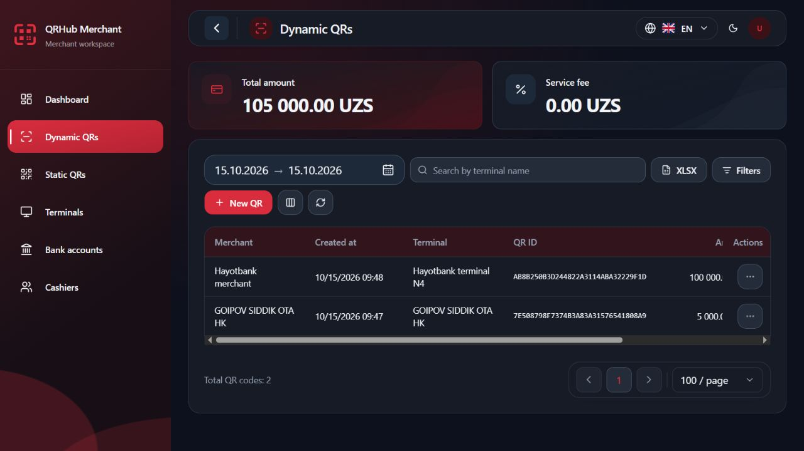
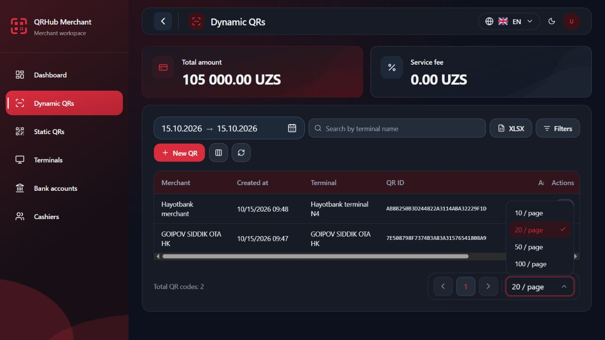
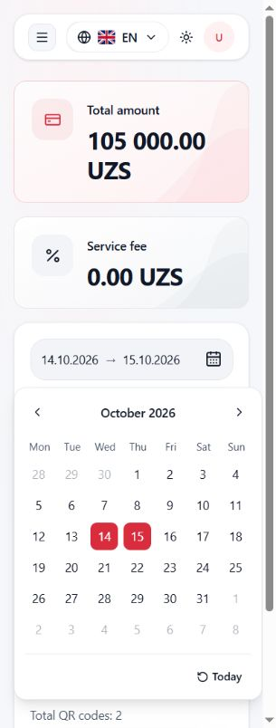

# UIX.DATE_PAGINATION.1 — Date trigger and pagination standardization

Verified 2026-10-15 in the existing local workspace. Status: COMPLETE within the browser and data limits below.

## Environment and scope

- Frontend: `D:/QR projects/qrhub-merchant-frontend`, HEAD `cf8a0e508fb6ee305a226f28ca5fe46a51502df6` plus existing uncommitted changes, preserved.
- Windows, PowerShell, Node v24.14.0; React 19, Vite 8.3, Tailwind 4.3.3, Vitest 5.0.0.
- Existing Vite listener at `http://127.0.0.1:5173`; no additional server started. Both 127.0.0.1 and ::1 listeners were already present.
- Real browser: Codex In-app Browser, authenticated existing local session; live staging integration via `https://test-merchants.qrhub.uz/api/qh-merchant-auth-api` and `https://test-merchants.qrhub.uz/api/qh-merchant-web-api`.
- Existing configuration and credentials were preserved. Only read-only list/filter interactions were used. No records created, cancelled, assigned or modified. No backend, RBAC, database, Redis, deployment or commit changes.
- Browser settings restored to English/dark and the viewport override reset after verification.

## Component and behavior audit

The single shared `DateRangeQuickFilter` serves Dynamic QR (`DynamicQrQuickFilters`) and Dashboard (`DashboardQuickDateFilter`). There is no second picker. Its existing popup, localized month captions, range state, today/reset actions, selection and immediate apply behavior are retained. The unused optional custom trigger label remains supported.

Before this change, the default trigger used h-9, 14px text, a 16px icon and a desktop minimum width of 256px. Two global CSS selectors matched an Uzbek accessible label and overrode Dashboard/Dynamic QR heights only in that language. In the English browser the trigger measured 256 × 36px. The English presentation adapter intentionally used locale-specific US numeric dates; Uzbek/Russian used day-first numeric dates. This inconsistency was display policy, not a date query defect.

`PaginationBar` is shared by Dynamic QR, Static QR, Terminals, Bank accounts, Cashiers and P5. Existing production defaults are all 20. Before this change the selectable list was 10/20/25/50, duplicated in the component, Dynamic QR query validator, management query validator and P5 validator. A fallback option could additionally expose any supplied server size. The D4 preview had its own 10/25/50 options over the same list contract.

All six production list controllers already reset `page: 0` when changing size by spreading the current filter state. This retains search and structured filters. Their React Query keys include both size and page, so a size change uses a distinct list query and refetches without manual invalidation. Server page metadata and content remain authoritative; production list results are not sliced again on the client. Dashboard's independently contracted latest-10 transaction feed and dropdown lookups are unchanged.

## Implementation

### Trigger and date display

- Shared trigger: 48px height, 16px radius, desktop width 320px, responsive full width, minimum width zero, balanced 12px/16px padding, a 20px trailing icon and tabular date text.
- Text uses 14px at the narrowest width, 16px from 375px, and 18px from the desktop trigger breakpoint. This keeps both complete dates and the icon usable at 320px.
- Uses existing muted/input/border theme tokens. Dark computed background was rgb(29,41,57), border rgb(71,84,103); light background rgb(242,244,247), border rgb(228,231,236), text rgb(16,24,40).
- Removed only the locale-dependent date-trigger CSS rules; retained the adjacent search-input styling.
- Added `formatDateRangeEndpoint` to the existing shared calendar presentation module. The approved reference format is **DD.MM.YYYY for the shared trigger in uz/ru/en**. It validates an ISO date-only carrier and slices its lexical components. It does not instantiate a Date, use UTC or alter the carrier. Invalid/incomplete drafts remain neutral.
- Other table/chart/date-time formatting continues to follow the existing locale policy. Wire queries remain YYYY-MM-DD. Selected values, range validation, month navigation and selection logic are unchanged.
- Preserved localized accessible names and added an `aria-describedby` relationship to the rendered selected range. Existing shared pointer and focus-visible behavior remains in effect.

### Pagination

`PAGE_SIZE_OPTIONS = [10, 20, 50, 100]` and its derived `PageSize` type now live in `shared/pagination.ts`. `isPageSize` is used by all three query validation paths. The existing contracts module re-exports the type for callers. `DEFAULT_PAGE_SIZE` remains 20.

`PaginationBar` renders only those four options; it no longer inserts an arbitrary extra option. 25 is rejected by the approved frontend query policy and cannot be selected. There is no persisted legacy page-size setting to migrate. The D4 preview now uses the same constant and validator. Existing size=25 test fixtures were updated to 100 without changing QR status=25, which is an independent valid business code.

Disabled/loading/empty behavior, page windows, total count, server decoding, request endpoints, RBAC and date logic are unchanged.

## Backend size=100 compatibility

Read-only source inspection was completed **before enabling 100**, against sibling repository `D:/QR projects/qrhub-merchant-service`, HEAD `894663f7337da1946c21d2003cb19018b128eb55`.

Under `qh-merchant-web-api/src/main/java/uz/wt/qh/merchant/web/api/`:

| Endpoint | Resource | Service / repository evidence | Result |
| --- | --- | --- | --- |
| /dynamic-qrs/get-all | resource/DynamicQrResource.java | DynamicQrServiceImpl; TransactionQrsRepositoryImpl.java:89,154–155 | Supports 100 |
| /static-qrs/get-all | resource/StaticQrResource.java | StaticQrServiceImpl; StaticQrRepositoryImpl.java:46,61–62 | Supports 100 |
| /terminals/get-all | resource/TerminalResource.java | TerminalServiceImpl; TerminalRepositoryImpl.java:90,139–140 | Supports 100 |
| /bank-accounts/get-all | resource/BankAccountResource.java | BankAccountServiceImpl; BankAccountRepositorImpl.java:38,58–59 | Supports 100 |
| /cashiers/get-all | resource/CashierResource.java | CashierServiceImpl; CashierRepositoryImpl.java:42,83–84 | Supports 100 |
| /p5/get-all | resource/P5Resource.java | P5ServiceImpl; P5RepositoryImpl.java:61,88–89 | Supports 100 |

These resources take integer page/size parameters (backend default 10, unchanged), services pass them through and return the requested size in PageResponse, and repositories bind the supplied size into `LIMIT :size OFFSET :offset`, with offset = page × size. No annotation/configuration/clamp limiting these endpoints below 100 was found. They do not use a capped Spring Pageable resolver. The frontend explicitly sends its preserved default 20.

Live browser selection of 100 succeeded on Dynamic QR (2 records), Terminals (4), Static QR (4), Bank accounts (0), Cashiers (0). After loading, their response-driven pagination showed 100 and correct totals/first-page or no-pages state. P5 had no visible authorized navigation entry in this session; its compatibility is supported by source inspection and query/bridge tests, not a live P5 request.

There were fewer than 100 accessible records per list. A full 100-record response and multi-page staging traversal could not be demonstrated from this account; no synthetic records or grants were created. There is no discovered contract blocker and no silent frontend truncation.

## Actual browser observations

### Dynamic QR

- Baseline: English dark trigger showed `10/15/2026 → 10/15/2026`, 256 × 36px, 14px font.
- Updated: `15.10.2026 → 15.10.2026`, 320 × 48px, 18px font, 20px icon, computed pointer cursor.
- Enter opens the popup and places focus on Previous month. Mouse chose October 14; Tab then Enter chose October 15. The trigger immediately displayed `14.10.2026 → 15.10.2026`, popup closed, focus returned to the trigger and list refreshed. Today restored the single-day range.
- Dropdown options were exactly 10/20/50/100, with localized units and no 25. Selected 100, 10, 50 and restored 20 through actual popup interactions. 100/10 displayed the same two records and correct totals. Search `Hayotbank` returned one record; changing 10 → 50 kept the search and date and returned the same one-record result. Clearing search restored two records.
- Existing loading state temporarily removes the list/pagination while a different query loads. An attempted automation selection during that transition was retried after observing the settled state; no product change was made to this behavior.
- Previous/Next remained disabled for single-page results; empty Bank accounts/Cashiers showed no-pages and disabled navigation, with size selection still available.

### Responsive and themes

Both light and dark were measured at every requested width. Popup internals were not redesigned.

| Viewport width | Trigger width / height | Trigger font | Popup horizontal bounds | Visible panels | Page overflow |
| --- | --- | --- | --- | --- | --- |
| 320 | 235.2 / 48px | 14px | 16–304px | 1 | No |
| 375 | 290.4 / 48px | 16px | 16–359.2px | 1 | No |
| 390 | 305.6 / 48px | 16px | 16–374.4px | 1 | No |
| 768 | 320 / 48px | 18px | 49–721px | 2 | No |
| 1280 | 320 / 48px | 18px | 325–997px | 2 | No |

The full date range and icon fit without overlap/clipping at every width. Popup positioning and readable calendar layout were preserved. Screenshots were visually inspected, including the narrowest light view and dark mobile Dashboard.

Dashboard retained its initial `09.10.2026 → 15.10.2026` seven-day range. Previous/Next month changed captions and Escape closed the popup without changing the range, restoring trigger focus. Its desktop light, 320px Uzbek/Russian light and 390px English dark layouts fit without page overflow. Locale switching preserved numeric dates and produced `Oktabr 2026`, `Октябрь 2026`, `October 2026` captions and translated control names. Chart-period labels retain their existing locale formatting intentionally.

### Accessibility and limits

- Real keyboard activation, date selection, focus restoration and Escape were checked. Existing focus indicators were visible, including the calendar navigation focus ring.
- Trigger accessible names remain translated. Selected range is explicitly described through aria-describedby. Page-size control remains a labeled combobox with translated per-page units. Disabled navigation states are exposed in the browser accessibility tree.
- No screen-reader/audio session or physical touch/software keyboard was available. Physical mobile testing is NOT_VERIFIED. Viewport evidence is responsive browser evidence only.
- Nonfirst-page size reset is confirmed by all production controller callbacks and existing state/pagination/query-key regressions. The small staging datasets did not allow a live nonfirst-page transition. First/last windows, empty/loading, query identity and filter retention are covered by tests/source plus the browser observations above.

## Quality gates

- Typecheck: PASS (`npm run typecheck`, locale validation and tsc).
- Lint: PASS; existing Fast Refresh export warnings in Button/Badge remain.
- Focused tests: 232 passed in 16 files, covering date presentation/layout/lifecycle, immediate global apply, Dashboard runtime, i18n, pagination, six query policies, query keys, API mapping and filter state. The shared Select regression selecting 100 also passed in the final full run.
- Full suite: 2,247 passed in 240 files (`npm test -- --maxWorkers=2`). An initial run caught the obsolete 25-selection expectation; it was corrected to 100 and the complete suite rerun successfully.
- Production build: PASS (`npm run build`, Vite 8.3.0). Existing large-chunk advisory remains.
- `git diff --check`: PASS (only Git's existing LF-to-CRLF advisory warnings).

## Changed paths for this checkpoint

Prior unrelated uncommitted changes are preserved. This list identifies only edits made for UIX.DATE_PAGINATION.1; some files also contain earlier checkpoint work.

```text
docs/audits/UIX_DATE_PAGINATION_STANDARDIZATION.md
src/app/read/createLiveReadApi.test.ts
src/components/ui/select.test.tsx
src/dev/day4/Day4PreviewRoot.tsx
src/dev/read/read-simulator.test.ts
src/features/cashiers/create-cashier.test.ts
src/features/dynamic-qr/DateRangeQuickFilter.test.tsx
src/features/dynamic-qr/DateRangeQuickFilter.tsx
src/features/dynamic-qr/export-filters.test.ts
src/features/dynamic-qr/filters.test.ts
src/features/dynamic-qr/filters.ts
src/features/static-qr/page-state.test.ts
src/features/terminals/page-state.test.ts
src/index.css
src/shared/api/read-keys.test.ts
src/shared/contracts/management-filters.ts
src/shared/contracts/management-read.test.ts
src/shared/contracts/merchant-read.ts
src/shared/contracts/p5-filters.ts
src/shared/contracts/page-size-policy.test.ts
src/shared/filters/debounced-search.query.test.tsx
src/shared/filters/debounced-search.test.tsx
src/shared/filters/search-contract-parity.test.ts
src/shared/pagination.test.ts
src/shared/pagination.ts
src/shared/presentation/calendar.test.ts
src/shared/presentation/calendar.ts
src/shared/ui/PaginationBar.test.tsx
src/shared/ui/PaginationBar.tsx
src/shared/ui/shared-ui.i18n.test.tsx
```

Screenshots and measured browser evidence (new files):

```text
docs/audits/evidence/UIX_DATE_PAGINATION/after-desktop-dark.jpg
docs/audits/evidence/UIX_DATE_PAGINATION/before-desktop-dark.jpg
docs/audits/evidence/UIX_DATE_PAGINATION/cashiers-100-light.jpg
docs/audits/evidence/UIX_DATE_PAGINATION/dark-1280.jpg
docs/audits/evidence/UIX_DATE_PAGINATION/dark-320.jpg
docs/audits/evidence/UIX_DATE_PAGINATION/dark-375.jpg
docs/audits/evidence/UIX_DATE_PAGINATION/dark-390.jpg
docs/audits/evidence/UIX_DATE_PAGINATION/dark-768.jpg
docs/audits/evidence/UIX_DATE_PAGINATION/dashboard-en-dark-390.jpg
docs/audits/evidence/UIX_DATE_PAGINATION/dashboard-light-desktop.jpg
docs/audits/evidence/UIX_DATE_PAGINATION/dashboard-ru-light-320.jpg
docs/audits/evidence/UIX_DATE_PAGINATION/dashboard-uz-light-320.jpg
docs/audits/evidence/UIX_DATE_PAGINATION/light-1280.jpg
docs/audits/evidence/UIX_DATE_PAGINATION/light-320.jpg
docs/audits/evidence/UIX_DATE_PAGINATION/light-375.jpg
docs/audits/evidence/UIX_DATE_PAGINATION/light-390.jpg
docs/audits/evidence/UIX_DATE_PAGINATION/light-768.jpg
docs/audits/evidence/UIX_DATE_PAGINATION/options-desktop-dark.jpg
docs/audits/evidence/UIX_DATE_PAGINATION/responsive-observations.json
docs/audits/evidence/UIX_DATE_PAGINATION/terminals-100-light.jpg
```







## Final checkpoint

CHECKPOINT: UIX.DATE_PAGINATION.1

STATUS: COMPLETE

DATE_TRIGGER_DESIGN: PASS

DATE_DISPLAY_FORMAT: DD.MM.YYYY in the shared trigger for uz/ru/en

DATE_FILTER_LOGIC: PRESERVED

MOBILE_RESPONSIVENESS: PASS (viewport checks; physical mobile not verified)

DARK_LIGHT_THEMES: PASS

PAGINATION_OPTIONS: 10,20,50,100

PAGINATION_25_REMOVED: YES

DEFAULT_PAGE_SIZE: 20

BACKEND_SIZE_100: SUPPORTED (source for all six endpoints; live response-driven UI for five accessible lists)

PAGE_RESET_CLAMP: PASS (existing page-zero reset; live first/empty pages and source/test evidence)

API_QUERY_MAPPING: PASS

I18N: PASS

BROWSER_VERIFICATION: PASS

TYPECHECK: PASS

LINT: PASS

FOCUSED_TESTS: 232 passed / 16 files; shared Select also passes in final full suite

FULL_TEST_SUITE: 2247 passed / 240 files

BUILD: PASS

BACKEND_CHANGED: NO

STAGING_DEPLOYED: NO

FILES_CHANGED: Exact paths listed above, including evidence files; prior checkpoint changes preserved.

NEXT_STEP: Review date/pagination appearance and continue frontend improvements.
