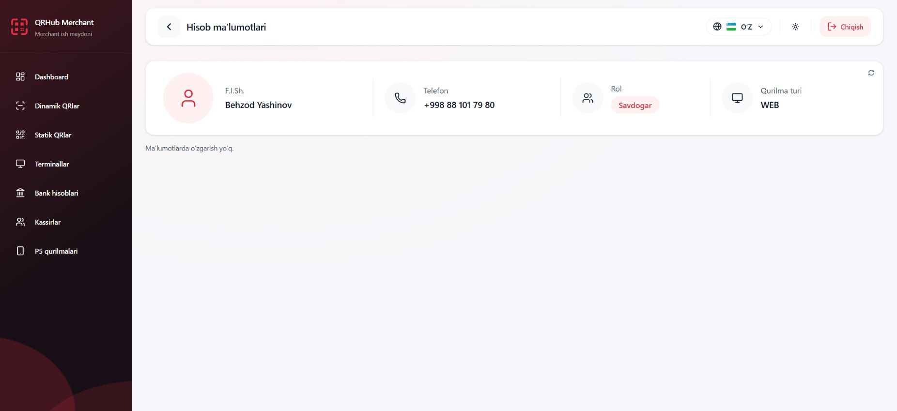
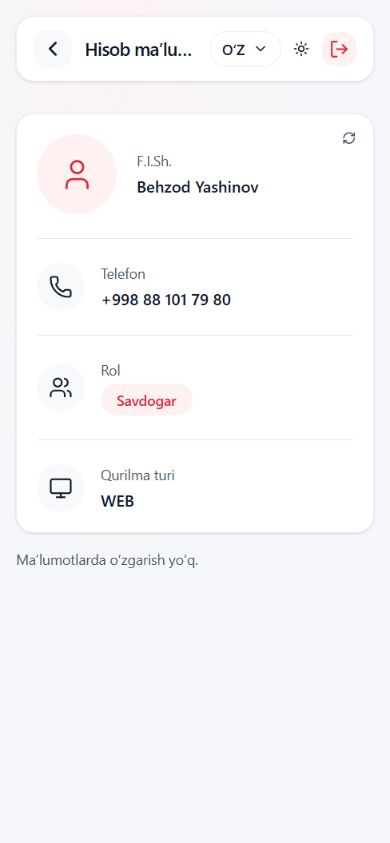

# UIX.PROFILE.REDESIGN.MATCH_REFERENCE.2

Image 1 is the target. The prior implementation used an overview row and a separate personal-information area; this task replaces that structure with the requested single horizontal card. Image 2 was treated as the incorrect result, not the target.

## Result

- Account-only header: actual Back, localized account-information title, language selector, compact theme switch and direct logout at the right. No decorative profile icon or wrapper between Back and heading. Existing other-page headers retain their previous mode.
- Wide card: large circular user icon, full name, formatted phone, red role pill and device type; vertical dividers on desktop, two columns on tablet, stacked fields on mobile. Existing Card/Button/theme tokens and existing data binding are reused.
- WEB denotes the current web client environment. GET_ME does not contain device type, so no profile property, API contract or server value was fabricated. The label/value comes through the locale catalog.
- Role labels remain display-only exact mappings for recognized roles, with neutral fallback for unknown/mixed roles. Permission-based RBAC is unchanged.
- Back uses existing router history when available and the existing root landing route for direct entries. Both direct-entry fallback and return from a Dashboard→Account visit were checked in the browser.
- Existing manual refresh remains as a compact tooltip action in the card corner. Existing pending state and changed/unchanged/failure feedback remain; feedback is below the card to preserve its single-row proportions.
- Header logout calls the same central auth action, with existing critical-copy guard and pending state. No real logout was triggered; mocked integration tests verify logout delegation/session clearing.

## Browser verification

Existing Vite runtime was already listening on ::1:5173 (PID 7224). It was reused at http://localhost:5173/account; the previously mentioned 127.0.0.1 origin was unreachable. No second server was started. An existing authenticated session on localhost supplied actual profile data. No credentials, backend, database, Redis, permissions or authentication lifecycle code were changed.

Light and Dark were inspected. Uzbek/Russian/English selection and translated role/device labels were checked. The viewport was reset and original English/System preferences restored. Physical mobile and screen-reader testing were not performed.

Final measurements (CSS pixels):

| Viewport | Header height | Card height | Layout | Horizontal overflow |
|---|---:|---:|---|---|
| 1852×850 (849 requested; renderer rounded) | 77.6 | 153.6 | Four sections in one row | None |
| 1440×900 | 77.6 | 153.6 | Four sections in one row | None |
| 1280×720 | 77.6 | 153.6 | Four sections in one row | None |
| 768×1024 | 77.6 | 242.4 | Two columns | None |
| 390×844 | 66.1 | 420 | One column | None |
| 320×740 | 65.6 | 420 | One column | None |

At narrow widths, the title truncates visually while retaining its full accessible name, the locale selector uses its opt-in compact mode, and logout keeps an accessible icon button. No control overlaps or horizontal overflow were found. Default locale-selector markup on other pages remains unchanged; its existing regression suite passes.

## Quality gates

Typecheck PASS. Lint PASS (existing Button/Badge Fast Refresh export warnings). Focused account/header/router/locale/RBAC tests PASS: 118 tests across 7 files. Full frontend suite PASS: 2,321 tests across 242 files. Production build PASS with existing large-chunk warning. git diff --check PASS.

Earlier Account redesign/header-cleanup uncommitted changes were preserved and updated only where this explicit replacement requires it. Historical reports/evidence were not rewritten. No commit or deployment.

## Exact files changed by this task

- D:/QR projects/qrhub-merchant-frontend/src/app/LiveRouter.tsx
- D:/QR projects/qrhub-merchant-frontend/src/app/layout/Header.tsx
- D:/QR projects/qrhub-merchant-frontend/src/app/shell-auth-account.i18n.test.tsx
- D:/QR projects/qrhub-merchant-frontend/src/features/account/AccountPage.tsx
- D:/QR projects/qrhub-merchant-frontend/src/features/account/AccountPage.test.tsx
- D:/QR projects/qrhub-merchant-frontend/src/shared/i18n/LocaleSelect.tsx
- D:/QR projects/qrhub-merchant-frontend/src/locales/uz/account.json
- D:/QR projects/qrhub-merchant-frontend/src/locales/ru/account.json
- D:/QR projects/qrhub-merchant-frontend/src/locales/en/account.json
- D:/QR projects/qrhub-merchant-frontend/src/shared/i18n/generated.d.ts
- D:/QR projects/qrhub-merchant-frontend/src/shared/i18n/metadata.generated.ts
- D:/QR projects/qrhub-merchant-frontend/docs/audits/UIX_PROFILE_MATCH_REFERENCE_2.md
- D:/QR projects/qrhub-merchant-frontend/docs/audits/evidence/UIX_PROFILE_MATCH_REFERENCE_2/final-measurements.json
- D:/QR projects/qrhub-merchant-frontend/docs/audits/evidence/UIX_PROFILE_MATCH_REFERENCE_2/final-uz-dark-desktop.jpg
- D:/QR projects/qrhub-merchant-frontend/docs/audits/evidence/UIX_PROFILE_MATCH_REFERENCE_2/final-uz-dark-mobile.jpg
- D:/QR projects/qrhub-merchant-frontend/docs/audits/evidence/UIX_PROFILE_MATCH_REFERENCE_2/final-uz-light-1280x720.jpg
- D:/QR projects/qrhub-merchant-frontend/docs/audits/evidence/UIX_PROFILE_MATCH_REFERENCE_2/final-uz-light-1440x900.jpg
- D:/QR projects/qrhub-merchant-frontend/docs/audits/evidence/UIX_PROFILE_MATCH_REFERENCE_2/final-uz-light-1852x849.jpg
- D:/QR projects/qrhub-merchant-frontend/docs/audits/evidence/UIX_PROFILE_MATCH_REFERENCE_2/final-uz-light-320x740.jpg
- D:/QR projects/qrhub-merchant-frontend/docs/audits/evidence/UIX_PROFILE_MATCH_REFERENCE_2/final-uz-light-390x844.jpg
- D:/QR projects/qrhub-merchant-frontend/docs/audits/evidence/UIX_PROFILE_MATCH_REFERENCE_2/final-uz-light-768x1024.jpg
- D:/QR projects/qrhub-merchant-frontend/docs/audits/evidence/UIX_PROFILE_MATCH_REFERENCE_2/final-uz-light-desktop.jpg
- D:/QR projects/qrhub-merchant-frontend/docs/audits/evidence/UIX_PROFILE_MATCH_REFERENCE_2/ru-dark-320x740.jpg

CHECKPOINT: UIX.PROFILE.REDESIGN.MATCH_REFERENCE.2

STATUS: COMPLETE

MATCHES_IMAGE_1: YES (visual composition; actual profile and localized values retained)

ORANGE_X_SECTION_REMOVED: YES

TYPECHECK: PASS

LINT: PASS

BUILD: PASS
