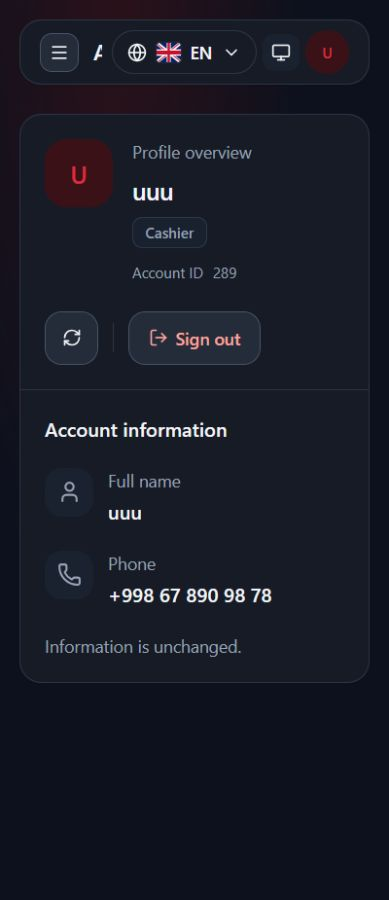
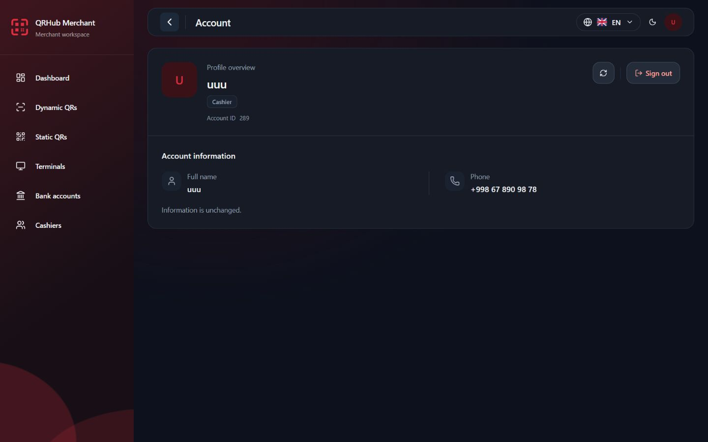
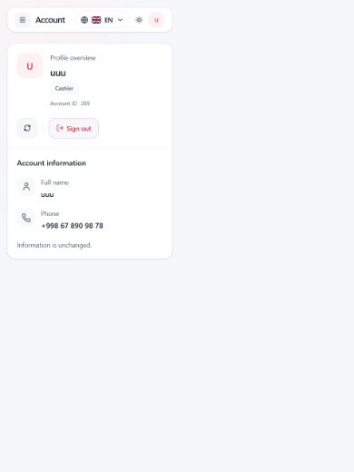

# UIX.PROFILE.REDESIGN.1 — Account page redesign

## Result and design rationale

The Account page now uses one balanced, full-width profile card capped at 72rem, replacing the narrower 48rem card. A profile overview establishes identity with initials, accepted full name, a localized role badge and a quiet account ID. A divided personal-information area uses semantic label/value pairs for name and formatted phone. Desktop places compact actions beside identity and personal fields in two columns; smaller screens move actions below identity and stack fields.

The redesign retains empty page space naturally when only two profile fields exist; it does not add unsupported activity, security settings, editable fields or decorative illustrations merely to fill the screen. It improves width and hierarchy rather than stretching the card vertically. Red is reserved for the initials avatar and sign-out accent; borders, surfaces, typography and corners use the QRHub tokens.

The original screenshot was treated as a BEFORE reference. The locally captured before layout had a small generic user icon, a repeated title, two boxed fields, and a separate action row without a profile overview. The refreshed design uses fewer nested boxes and separates ordinary refresh from sign out with spacing and a divider.

## Audit and preserved behavior

Inspected AccountPage, Card/Button, shared tooltip conventions, Header/LiveRouter/layout, AuthProvider, SessionController, Profile/GET_ME contracts, permission policies, phone formatting, locale catalogs and account/session tests. The runtime already supplies a single accepted profile through useAuth. No authentication state store or production data layer was added.

- Actual profile values come from the existing accepted GET_ME profile. The current Profile contract has userId, phone, nullable fullname, roles and permissions; it has no device type. Device information is therefore omitted.
- Display-only role mapping recognizes exact ROLE_MERCHANT and ROLE_MERCHANT_USER identifiers. Existing management contract documentation identifies the latter as the cashier role. A single unique recognized role gets a localized Merchant/Cashier label. Empty, unknown or mixed roles get a neutral Account user label. Duplicate copies of the same recognized role remain recognized. No role identifier supplies permissions or route access.
- The /account route still uses profile.read → exact GET_ME permission membership. AuthProvider, SessionController, route policy, permissions, API adapters, token refresh, auth epochs, device lease, cache clearing and session protection are untouched.
- Manual refresh still calls actions.refreshProfile, disables during refresh or logout, and displays the existing changed/unchanged/failed localized feedback in a polite status region. Refresh now has an icon-only 44px button with accessible label, aria-busy and the same localized action text in a Radix tooltip.
- Sign out still calls actions.logout, retains the critical-translation availability guard, disabled/logout-pending behavior and localized signing-out copy. It remains a native button; it does not navigate through an invented link or add a new workflow.
- Existing formatUzbekPhoneDisplay is reused. Name and ID remain escaped text; missing name and empty phone receive localized Not provided. No tel link or edit behavior is invented.

Reused components: QRHub Card, Button, central useAuth, typed useMessages, phone formatter and Radix tooltip primitives. The tooltip follows shared popup colors, collision padding and keyboard focus behavior. InfoTooltip itself is reserved for informational icons, so the refresh action uses Tooltip.Trigger asChild around the existing Button.

## Implementation and tests

Production source changes are confined to AccountPage and account translations/generated locale metadata. Tests cover accepted identity/phone, initials, cashier/merchant/unknown role labels in all three languages, absent/ambiguous roles, nullable name, empty phone fallback, long literal names, refresh action/pending/busy/spinner/feedback, logout action/pending and absent-profile rendering. Existing integration tests verify GET_ME-based route access, role-independent grants, real AuthProvider refresh feedback, mocked logout session clearing and protected routes, token/device storage and language-switch preservation.

The initial typecheck identified readonly assignments in test setup; those fixtures were corrected to immutable construction. Final checks below are after that correction. No auth interfaces were weakened to satisfy tests.

## Browser verification

Environment: Windows/PowerShell; repository D:\QR projects\qrhub-merchant-frontend, starting HEAD 807ddb081054137715e6c636ad2d461ce2b0302e. Node v24.14.0, existing local Vite v8.3.0 at http://127.0.0.1:5173/account. Existing listeners were checked (127.0.0.1 PID 14408 and ::1 PID 15284); no second server was started. Codex in-app Chromium browser used the existing authorized local integration session. No credential or permission change was needed. Browser build number and physical display scaling are not exposed by the tool.

The actual page showed the accepted identity, formatted phone and recognized cashier label. Keyboard activation of refresh showed the disabled Refreshing state, followed by Information is unchanged. The tooltip appeared on keyboard focus, with aria-describedby pointing to its Radix description and a computed 3px focus ring. Focus advanced from refresh to sign out; real sign out was deliberately not activated. Its action/session clearing behavior is covered by tests with mocked APIs.

| Viewport | Theme coverage | Horizontal overflow | Layout/actions |
|---|---|---|---|
| 1440×900 | Light + Dark | None | 1112px card, actions alongside overview, two information columns |
| 768×1024 | Light + Dark | None | 720px card, actions below overview, two information columns |
| 390×844 | Light + Dark | None | About 358px card, stacked fields, actions reachable |
| 375×812 | Light + Dark | None | About 343px card, stacked fields, actions reachable |
| 320×740 | Light + Dark | None | 288px card, stacked fields, actions reachable |

Document scrollWidth equals viewport width for these actual-page measurements; the section has no horizontal overflow. Both action buttons are 44px high and refresh is 44px wide. The actual profile card measured about 368px high on desktop, 436px on tablet and 468px on mobile after refresh feedback appeared. Content starts below the global header without overlap. The existing global header title truncates at the narrowest width; profile controls do not collide with it. No global-header change was made.

Uzbek and Russian were also selected on the real page at 320px: overview, account ID, role, name/phone labels, actions and feedback translated without raw keys or horizontal overflow. English and Dark were restored and viewport overrides reset.

A separate local fixture renders the production AccountPage through a synthetic AuthContext, with no API calls or credentials. Its 288-character unbroken synthetic name and unknown role wrap correctly on a 320px viewport and a 1280px-wide desktop. No h2/dd text element overflows horizontally. The long fixture naturally scrolls vertically; controls and fields follow the full name rather than clipping it. The fixture's actions are explicitly inert and do not claim to test real session behavior.

Measurements: [responsive-measurements.json](evidence/UIX_PROFILE_PAGE_REDESIGN/responsive-measurements.json).

## Screenshots

[Locally captured before](evidence/UIX_PROFILE_PAGE_REDESIGN/before-dark-desktop.jpg)

The evidence folder includes all five viewports in both themes, Uzbek/Russian 320px views, keyboard tooltip/focus evidence and full-page synthetic long-name views.

## Accessibility

- Existing shell h1 → profile-name h2 → information h3; section is named by its information heading.
- Definition lists expose account ID and personal label/value relationships. Decorative initials/icons are aria-hidden.
- Native refresh/sign-out buttons retain keyboard activation and shared focus indicators. No positive tabindex or new focus trap.
- Icon-only refresh has a localized accessible label; tooltip responds to focus and uses Radix description semantics. Disabled state and aria-busy expose pending refresh.
- Outcome feedback is role=status with aria-live=polite. Existing logout semantics and pending text are retained.
- The only added animation is the pending refresh icon using motion-safe:animate-spin, so reduced-motion users do not receive the spin.
- Theme surfaces, secondary text, separators and red action accent were visually checked in Light/Dark. No physical screen reader or formal contrast certification was performed.

## Quality gates

| Gate | Final result |
|---|---|
| Typecheck / locale integrity | PASS |
| Lint / i18n boundaries and literals | PASS; existing Button/Badge Fast Refresh export warnings only |
| Focused Account + shell/auth localization + permission/integration tests | PASS — 91 tests, 5 files |
| Full frontend test suite | PASS — 2,320 tests, 242 files; final run 107.35s |
| Production build | PASS; existing large-chunk warning |
| git diff --check | PASS |

## Limitations and safety

Real logout was not triggered. Changed/failure refresh responses, merchant/unknown/empty roles, missing name, session invalidation and negative permissions use component/integration tests rather than changing the live identity or backend responses. Physical mobile touch/software keyboard and assistive-technology testing were not performed. The fixture is local evidence outside the production entry point; it adds no app route or auth store.

No backend, PostgreSQL, Redis, grants, credentials, API contracts or auth/session code changed. No commit or deployment. Starting working tree was clean; earlier task changes were already in the starting HEAD and remain preserved.

## Exact changed files

Paths relative to the repository root stated above:

- src/features/account/AccountPage.tsx
- src/features/account/AccountPage.test.tsx
- src/locales/en/account.json
- src/locales/ru/account.json
- src/locales/uz/account.json
- src/shared/i18n/generated.d.ts
- src/shared/i18n/metadata.generated.ts
- docs/audits/UIX_PROFILE_PAGE_REDESIGN.md
- docs/audits/evidence/UIX_PROFILE_PAGE_REDESIGN/after-en-dark-1440x900.jpg
- docs/audits/evidence/UIX_PROFILE_PAGE_REDESIGN/after-en-dark-320x740.jpg
- docs/audits/evidence/UIX_PROFILE_PAGE_REDESIGN/after-en-dark-375x812.jpg
- docs/audits/evidence/UIX_PROFILE_PAGE_REDESIGN/after-en-dark-390x844.jpg
- docs/audits/evidence/UIX_PROFILE_PAGE_REDESIGN/after-en-dark-768x1024.jpg
- docs/audits/evidence/UIX_PROFILE_PAGE_REDESIGN/after-en-light-1440x900.jpg
- docs/audits/evidence/UIX_PROFILE_PAGE_REDESIGN/after-en-light-320x740.jpg
- docs/audits/evidence/UIX_PROFILE_PAGE_REDESIGN/after-en-light-375x812.jpg
- docs/audits/evidence/UIX_PROFILE_PAGE_REDESIGN/after-en-light-390x844.jpg
- docs/audits/evidence/UIX_PROFILE_PAGE_REDESIGN/after-en-light-768x1024.jpg
- docs/audits/evidence/UIX_PROFILE_PAGE_REDESIGN/after-ru-light-320x740.jpg
- docs/audits/evidence/UIX_PROFILE_PAGE_REDESIGN/after-uz-light-320x740.jpg
- docs/audits/evidence/UIX_PROFILE_PAGE_REDESIGN/before-dark-desktop.jpg
- docs/audits/evidence/UIX_PROFILE_PAGE_REDESIGN/preview.html
- docs/audits/evidence/UIX_PROFILE_PAGE_REDESIGN/preview.tsx
- docs/audits/evidence/UIX_PROFILE_PAGE_REDESIGN/refresh-keyboard-tooltip-dark.jpg
- docs/audits/evidence/UIX_PROFILE_PAGE_REDESIGN/responsive-measurements.json
- docs/audits/evidence/UIX_PROFILE_PAGE_REDESIGN/synthetic-long-name-dark-320x740.jpg
- docs/audits/evidence/UIX_PROFILE_PAGE_REDESIGN/synthetic-long-name-light-1280x720.jpg

## Final checkpoint

CHECKPOINT: UIX.PROFILE.REDESIGN.1

STATUS: COMPLETE

PROFILE_OVERVIEW: PASS

PERSONAL_INFORMATION: PASS

ROLE_PRESENTATION: PASS

REFRESH_PRESERVED: YES

LOGOUT_PRESERVED: YES

RBAC_PRESERVED: YES

I18N: PASS

LIGHT_THEME: PASS

DARK_THEME: PASS

MOBILE_RESPONSIVE: PASS

ACCESSIBILITY: PASS (browser keyboard/DOM and automated checks; limitations above)

TYPECHECK: PASS

LINT: PASS

FULL_TEST_SUITE: 2,320 passed / 242 files

BUILD: PASS

BACKEND_CHANGED: NO

STAGING_DEPLOYED: NO

FILES_CHANGED: exact paths listed above.

NEXT_STEP: Review Account page redesign in the local browser.
