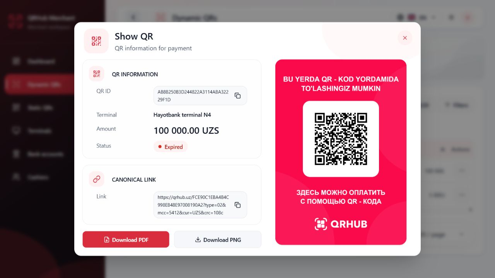
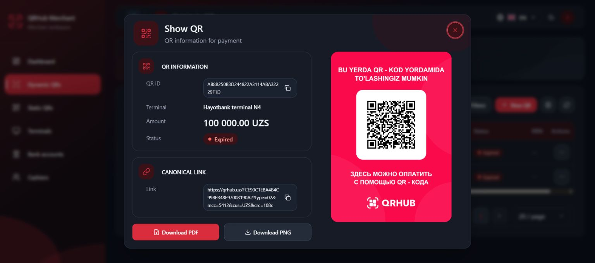
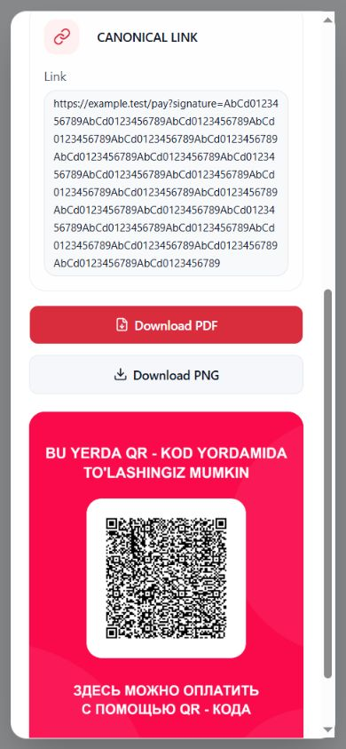

# UIX.SHOW_QR.MODAL_FIT.1

Verified 15 October 2026. Layout correction passes the requested desktop/mobile matrix. Overall verification is PARTIAL because dismissal focus restoration fails and native download completion could not be confirmed by the browser tool. No backend mutation, permission change, commit or deployment was performed.

## Environment and method

- Repository: D:\QR projects\qrhub-merchant-frontend; HEAD 7b2d3b19e82e119b55bbe094a8a71daccbc2d4d9.
- Windows, PowerShell, Node v24.14.0, existing Vite v8.3.0 runtime at http://127.0.0.1:5173. Existing port 5173 listeners were checked (IPv4 PID 14408, IPv6 PID 15284); no additional server was started.
- Codex in-app Chromium browser, existing authenticated local integration session. Browser version/physical display scaling were not supplied by the tool. Default browser zoom was retained; document CSS zoom=1 and visualViewport.scale=1. Viewport overrides are CSS pixels. No zoom-out workaround.
- Actual Dynamic QR, Static QR and terminal pages used read-only existing rows. Creation success used the production CreateQrDialog/form/adapter with a separate synthetic session and intercepted fetch responses in the attached local fixture. No fetch delegates to the backend; unexpected fetches throw. CSP limits connections to local origin/HMR. Synthetic access does not change real grants.
- Before/after DOM geometry, computed overflow, screenshots and keyboard/mouse interaction were observed. Viewport override was reset, theme restored to Dark, dialogs closed. Physical mobile touch/software keyboard was not tested.

## Confirmed cause and correction

The dialog had a viewport maximum height and overflow-y:auto, but its intrinsic composition could exceed that maximum. At fixed desktop width 896px, the 620:877 poster took about 525px, the shared header took 112px and body bottom padding added 20px. Cards also matter: metadata 256.8px, canonical link 155.2px, two 16px stack gaps and 44px actions make a roughly 488px left column. Grid gap is 20px; card padding is 16px. The taller column sets body height.

At 1536×680 the capped dialog was 632px tall (24px viewport margins), clientHeight 630 and scrollHeight 647: 17px actual overflow. The scrollbar reduced inner width and thus poster height to 515px, but the complete composition still exceeded the cap. At 1536×700 a scrollbar gutter was also observed around the intrinsic sizing threshold. The supplied screenshot alone does not establish its browser zoom or CSS viewport; these local measurements establish the reproducible case.

The four requested desktop sizes already had no true overflow with the tested standard row before the correction. This is not reported as a newly fixed failure at those sizes.

Changes are limited to QR presentation:

1. QrDisplayShell scopes desktop header padding to 16px above/below, reducing its height from 112 to 96px. Other DetailsDialog consumers and mobile header spacing are untouched.
2. BrandedQrPoster bounds desktop preview width by min(28rem, max(14rem, (100dvh - 15rem) × 620 / 877)). The 240px viewport budget leaves room for header, padding and creation-result actions. It retains a readable minimum and allows real overflow to scroll. Mobile keeps its full-width poster.
3. Existing regression tests assert the responsive preview constraint, retained ratio/canonical payload/export inputs, scoped header padding and retained max-height/overflow policy. The Radix test mock now forwards className so shell classes can be inspected.

No fixed dialog height or content-hiding overflow rule was introduced. The existing poster's overflow-hidden remains its rounded image boundary; the dialog retains overflow-y:auto.

## Measurements and responsive results

All requested sizes were tested in both Light and Dark with identical geometry. Height figures are rounded CSS pixels; client/scroll values are browser integer metrics. Full raw observations: [before](evidence/UIX_SHOW_QR_MODAL_FIT/before-measurements.json), [after](evidence/UIX_SHOW_QR_MODAL_FIT/after-measurements.json).

| Viewport | Before client/scroll | After client/scroll | After dialog height | Poster height | Fits in viewport | Internal vertical scroll | Clipped content | Poster readable | Downloads |
|---|---:|---:|---:|---:|---|---|---|---|---|
| 1920×1080 | 657/657 | 641/641 | 642.2 | 524.6 | YES | NO | NO | YES | Visible |
| 1440×900 | 657/657 | 641/641 | 642.2 | 524.6 | YES | NO | NO | YES | Visible |
| 1366×768 | 657/657 | 641/641 | 642.2 | 524.6 | YES | NO | NO | YES | Visible |
| 1280×720 | 657/657 | 604/604 | 605.6 | 480.0 | YES | NO | NO | YES | Visible |
| 1536×680 | 630/647 | 604/604 | 605.6 | 440.0 | YES | NO | NO | YES | Visible |
| 1280×500 | Not captured | 450/604 | 452 | 316.9 | YES, bounded surface | YES, necessary | NO, scroll reachable | YES, reduced preview | Scroll reachable |
| 390×844 | 818/1254 | 818/1254 | 820 | 437.9 | YES, bounded surface | YES, necessary | NO, scroll reachable | YES | Scroll reachable |

Desktop width is 896px. At 1280×720 margins grow from about 31px before to 57px after; at 1536×680 from 24px to about 37px. Mobile surface is 366.4px wide with 12px margins. Body overflow remains hidden while the modal is open. All measured scrollWidth values equal clientWidth; no horizontal modal overflow or second internal scroll container was observed. At 1280×500 actual scrollTop reached 153.6px, exposing both download buttons (44px tall) and the entire poster. At mobile, the poster bottom including logo was reached by scrolling. Close is visible at the initial top position; on scrolling it moves with the content and Escape remains usable.

## Screenshots

Before: [1280×720](evidence/UIX_SHOW_QR_MODAL_FIT/before-dark-1280x720.jpg), [reproduced scrollbar at 1536×680](evidence/UIX_SHOW_QR_MODAL_FIT/before-dark-1536x680.jpg).

The evidence directory includes initial screenshots for all seven sizes in both themes, plus Static QR, terminal QR, creation success, long metadata and short-screen bottom views. This is representative coverage, not a universal no-scroll guarantee.

## Shared coverage and functional checks

| Surface | Coverage/result |
|---|---|
| Dynamic QR Show QR | Actual existing expired row, both-theme full viewport matrix. Amount, terminal, status and original link retained. |
| Static QR Show QR | Actual active row, Light 1280×720; client/scroll=596/596. No fabricated amount. |
| Terminal static QR | Actual row with additional terminal ID, Light 1280×720; client/scroll=626/626. |
| Creation success | Actual production success dialog via isolated synthetic response, Light 1280×720; client/scroll=645/645, header=76px, poster=480px, New QR footer visible. Its existing separate header does not need the shared header override; it receives the shared preview constraint. |
| P5 QR | Source and full-suite evidence: uses QrDisplayShell and QrPresentation including additional device metadata. No authorized P5 navigation was present in the current live session; browser coverage NOT RUN. No grants changed. |
| Standalone creation result | Shares QrPresentation/BrandedQrPoster; source/full-suite coverage, not separately browser tested. |

Long-content fixture uses a 130-character ID, long terminal name and 370-character canonical link. At desktop client/scroll=670/910: necessary vertical scrolling remains. No dd horizontal overflow; poster ratio observed 0.7069715 (620/877). Mobile scroll reaches the full long link, both actions and poster logo. No text truncation or hidden-content workaround.

Copy QR ID and Copy link were checked against the exact displayed live values and both matched clipboard contents. A rapid repeated copy once showed the existing clipboard-failure feedback; a subsequent direct copy succeeded. No clipboard behavior was changed. Buttons remain enabled only when the poster is ready; PDF/PNG buttons are reachable by keyboard and mouse.

PNG action was clicked, but waiting for the browser download event timed out and reset the automation session. A saved-file path/content could not be verified, and a native PDF download was not claimed. Export preservation is supported by unchanged implementation, rendered preview natural dimensions 1240×1754, and passing PNG/PDF contract tests, rather than a native download pass.

### Accessibility finding

Dialog accessible title/description and close label remain present. Initial focus lands on Close; six sequential Tab steps stayed inside the dialog and cycled across copy/download/close controls. Escape and X both dismiss normally. However, dismissal after opening from a row menu leaves focus on BODY instead of restoring the originating control. The local long-content shell also exhibited BODY focus after dismissal. This is a confirmed remaining defect; dismissal logic was not changed in this layout patch. ACCESSIBILITY is therefore FAIL for the complete requested regression check, even though containment and dismissal work. A follow-up should supply an explicit stable opener/focus-return target for programmatically opened QR dialogs.

RBAC/action visibility/creation-scope checks and API contracts are untouched. Existing full-suite permission/scope tests pass; negative-role live-session verification was not performed.

## Preview and export separation

Only the outer DOM preview width changes. Aspect ratio remains 620:877. Hidden QR source remains size 600, error correction M, margin 4 and original canonical payload. renderQrPoster still uses the same 620×877 design at scale 2, producing 1240×1754 pixels. PNG generation, PDF A4 MediaBox 595.28×841.89, embedded image dimensions, branding text, logo, byte-stream/xref logic and download functions are unchanged. Existing renderer/download tests pass. The on-screen raster image is scaled by CSS; export canvas resolution is independent.

## Quality gates

| Gate | Result |
|---|---|
| Focused shell/presentation/poster/download tests | PASS — 18 tests, 4 files |
| Full frontend suite | PASS — 2,304 tests, 242 files (165.15s) |
| Typecheck | PASS |
| Lint | PASS — existing Button/Badge Fast Refresh export warnings only |
| Production build | PASS — existing large-chunk warning |
| git diff --check | PASS |

Existing Terminal Amount Gate uncommitted source/locales/generated types/tests and its report/evidence were preserved. They are not attributed to this task. No backend, database, Redis, permission grants, credentials or date/business logic changed.

## Final checkpoint

CHECKPOINT: UIX.SHOW_QR.MODAL_FIT.1

STATUS: PARTIAL

ROOT_CAUSE: Intrinsic two-column height (112px header + taller poster/metadata column + 20px bottom padding) exceeded the viewport-constrained scroll surface; confirmed 647px content against 630px available at 1536×680.

DESKTOP_1920_1080: PASS

DESKTOP_1440_900: PASS

DESKTOP_1366_768: PASS

DESKTOP_1280_720: PASS

MOBILE_390_844: PASS

UNNECESSARY_SCROLL_REMOVED: YES

SMALL_VIEWPORT_SCROLL: PRESERVED

QR_POSTER_ASPECT_RATIO: PRESERVED

PNG_PDF_EXPORT: PRESERVED (source/contracts; native saved downloads not verified)

COPY_ACTIONS: PASS

ACCESSIBILITY: FAIL (dismissal focus restoration; containment/Escape pass)

DARK_LIGHT_THEMES: PASS

TYPECHECK: PASS

LINT: PASS

FULL_TEST_SUITE: 2,304 passed / 242 files

BUILD: PASS

BACKEND_CHANGED: NO

STAGING_DEPLOYED: NO

FILES_CHANGED (this task only; paths relative to the repository above):

- src/features/dynamic-qr/BrandedQrPoster.tsx
- src/features/dynamic-qr/QrDisplayShell.tsx
- src/features/dynamic-qr/QrDisplayShell.test.tsx
- src/features/dynamic-qr/QrPresentation.test.tsx
- docs/audits/UIX_SHOW_QR_MODAL_FIT.md
- docs/audits/evidence/UIX_SHOW_QR_MODAL_FIT/after-dark-1280x500.jpg
- docs/audits/evidence/UIX_SHOW_QR_MODAL_FIT/after-dark-1280x720.jpg
- docs/audits/evidence/UIX_SHOW_QR_MODAL_FIT/after-dark-1366x768.jpg
- docs/audits/evidence/UIX_SHOW_QR_MODAL_FIT/after-dark-1440x900.jpg
- docs/audits/evidence/UIX_SHOW_QR_MODAL_FIT/after-dark-1536x680.jpg
- docs/audits/evidence/UIX_SHOW_QR_MODAL_FIT/after-dark-1920x1080.jpg
- docs/audits/evidence/UIX_SHOW_QR_MODAL_FIT/after-dark-390x844.jpg
- docs/audits/evidence/UIX_SHOW_QR_MODAL_FIT/after-light-1280x500.jpg
- docs/audits/evidence/UIX_SHOW_QR_MODAL_FIT/after-light-1280x720.jpg
- docs/audits/evidence/UIX_SHOW_QR_MODAL_FIT/after-light-1366x768.jpg
- docs/audits/evidence/UIX_SHOW_QR_MODAL_FIT/after-light-1440x900.jpg
- docs/audits/evidence/UIX_SHOW_QR_MODAL_FIT/after-light-1536x680.jpg
- docs/audits/evidence/UIX_SHOW_QR_MODAL_FIT/after-light-1920x1080.jpg
- docs/audits/evidence/UIX_SHOW_QR_MODAL_FIT/after-light-390x844.jpg
- docs/audits/evidence/UIX_SHOW_QR_MODAL_FIT/after-measurements.json
- docs/audits/evidence/UIX_SHOW_QR_MODAL_FIT/before-dark-1280x720.jpg
- docs/audits/evidence/UIX_SHOW_QR_MODAL_FIT/before-dark-1536x680.jpg
- docs/audits/evidence/UIX_SHOW_QR_MODAL_FIT/before-measurements.json
- docs/audits/evidence/UIX_SHOW_QR_MODAL_FIT/create-success-light-1280x720.jpg
- docs/audits/evidence/UIX_SHOW_QR_MODAL_FIT/long-content-light-1280x720.jpg
- docs/audits/evidence/UIX_SHOW_QR_MODAL_FIT/long-content-light-390-bottom.jpg
- docs/audits/evidence/UIX_SHOW_QR_MODAL_FIT/preview.html
- docs/audits/evidence/UIX_SHOW_QR_MODAL_FIT/preview.tsx
- docs/audits/evidence/UIX_SHOW_QR_MODAL_FIT/short-dark-1280x500-bottom.jpg
- docs/audits/evidence/UIX_SHOW_QR_MODAL_FIT/static-light-1280x720.jpg
- docs/audits/evidence/UIX_SHOW_QR_MODAL_FIT/terminal-light-1280x720.jpg

NEXT_STEP: Review Show QR layout and continue frontend UI improvements; address the documented focus-return defect and manually confirm saved PNG/PDF downloads.
