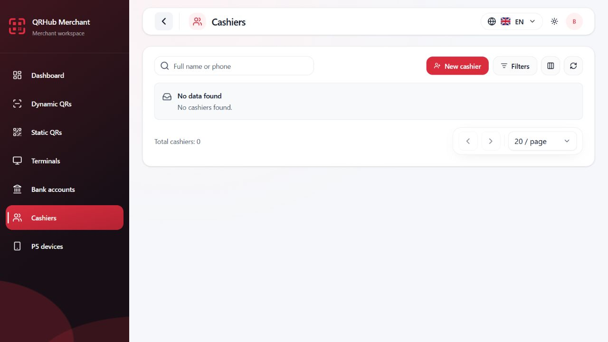
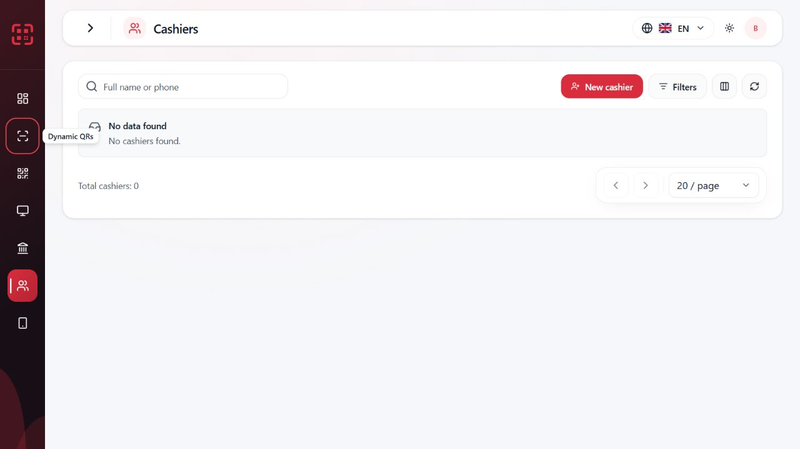

# UIX.SIDEBAR.STATE_ANIMATION.1

Verified 15 October 2026 in the existing local Vite runtime at http://localhost:5173. Repository: D:\QR projects\qrhub-merchant-frontend, starting HEAD 807ddb081054137715e6c636ad2d461ce2b0302e. Windows/PowerShell, Node v24.14.0, Vite v8.3.0, Codex in-app Chromium browser. Existing authorized session and runtime were reused; no second development server was started.

## State reset root cause

Each route renders its own LiveShell/LiveShellLayout subtree. Desktop collapsed state was initialized with useReducer(reduceSidebarCollapsed, false) inside LiveShellLayout. Moving between distinct route components unmounted that owner and initialized a new expanded owner. There was no explicit route-change collapse=false assignment and no desktop preference persistence in localStorage. Profile/grant rerenders within a surviving layout were not the original reset mechanism; route remounts were.

The real browser reproduced collapsed Dynamic QR → Static QR returning to expanded. The expanded state after navigation is recorded in before-route-reset.jpg. The static reference image was used for design continuity, not as evidence of temporal behavior.

## Animation root cause

The workspace already animated grid-template-columns for 200ms, but brand text switched instantly between sr-only and normal layout. Expanded navigation text was also conditionally replaced by tooltip-only markup. The brand row did not clip overflow, the subtitle could wrap, and collapsed/expanded header/link padding and justification changed icon positions. Together these allowed labels to paint while the width was still narrow and made alignment jump.

## Ownership and persistence decision

SidebarCollapseProvider now owns the single reducer above Routes in LiveRouter, keyed by the existing authenticated sessionScopeId. Route remounts, profile refreshes, grant changes, theme changes and locale changes therefore reuse the same owner. A new auth scope starts with the existing expanded default.

LiveShellLayout inherits this context. A standalone/demo/test shell gets one local owner only when there is no enclosing owner; nested provider boundaries inherit rather than allocate another reducer. There is no second competing store, module singleton or auth-state change.

The previous policy was RAM-only, so no permanent storage was introduced. Real browser refresh verification recorded beforeCollapsed=true and afterCollapsed=false. This preserves the previous hard-refresh behavior; route navigation now preserves the preference as requested. See reload-policy.json.

## Exact component changes

- LiveRouter: session-scoped provider above Routes; existing sidebar toggle ref passed to Header. Existing route definitions and GET_ME authorization remain unchanged.
- SidebarCollapseProvider / sidebar-collapse-context: shared RAM state, memoized state value and stable reducer dispatch; existing toggle reducer reused.
- LiveShellLayout: reads inherited desktop state; keeps its independent mobile reducer; brand row clips overflow and retains a fixed logo anchor; brand text remains mounted. A matchMedia listener closes an open mobile drawer when entering the existing 64rem desktop breakpoint, without modifying desktop preference. Listener cleanup occurs on unmount.
- Header: optional desktop toggle ref supports focus restoration when resize closes the drawer. Account-specific header behavior and the previous Account redesign remain intact.
- ShellNavigation: desktop labels remain mounted, clipped and nowrap, with a fixed icon anchor. Collapsed tooltips and explicit accessible names remain available. Mobile uses the existing full-label presentation. Supplied, centrally filtered navigation items remain the sole data source.
- sidebar.css: text opacity/transform only. Opening waits for the existing 200ms width transition, then fades/reveals over 100ms. Closing fades over 70ms without delay while clipping protects the narrowing panel. No new animation dependency, timer, per-frame measurement or React animation loop.

Reduced motion disables text transitions/transforms with a selector that also overrides collapsed-state specificity. The workspace retains its existing motion-safe transition and motion-reduce:transition-none behavior.

## Real browser observations

| Check | Observation |
|---|---|
| Collapsed route sequence | Dynamic QR → Static QR → Dashboard → Cashiers → Terminals all remained collapsed, 72px wide. Active links retained aria-current=page. |
| Account/profile refresh | Account navigation retained collapse; actual manual profile refresh retained collapse; existing Back and browser forward returned through authorized pages with collapse intact. |
| Expanded navigation | After expanding, navigation to Static QR retained expanded state. |
| Rapid toggles | Six successive toggles finished in the expected expanded state, width 272px, focus still on Collapse sidebar. No stranded label state observed. |
| Keyboard | Space activated toggle; aria-expanded and localized label reflected target state. Focus stayed on toggle. Tab to a collapsed navigation icon revealed its tooltip outside the rail. |
| Mobile drawer | At 390×844 only the mobile drawer was displayed; desktop aside computed display:none. Mobile labels had no desktop animation class. Body overflow was hidden while open. Escape restored focus to Open navigation. Selecting Cashiers closed the drawer without changing collapsed=true. |
| Open drawer → desktop | Resizing to 1280×720 closed the drawer, restored the 72px desktop rail and focused Expand sidebar. No overlapping open drawer remained. |
| Branding/locales | Expanded width 272px; English/Uzbek label width about 121px and Russian about 181px, within the available 188px. Computed whitespace was nowrap. Brand names/localization were not changed. |
| Themes | Dark/System and explicit Light were checked. Final Light screenshots were captured after confirming root was not dark and header background was rgb(255,255,255). |

### Intermediate animation evidence

Initial snapshot-only loops often returned cached or settled frames and were not treated as a frame-rate measurement. A later keyboard interaction plus fresh frame capture produced actual intermediate geometry:

| Phase | Sidebar width | Brand opacity | Logo X | First nav icon X |
|---|---:|---:|---:|---:|
| Collapsed endpoint | 72px | 0 | 16px | 26px |
| Closing sample | 130.6875px | 0 | Not sampled in this record | Not sampled in this record |
| Opening sample | 242.05px | 0 | 16px | 26px |
| Expanded endpoint | 272px | 1 | 16px | 26px |

The opening sample's computed reveal delay was 0.2s and brand clipping was hidden; at the completed width the brand was visible. The icon/logo anchors match the collapsed endpoint. These runtime measurements and captured intermediate frames support the reveal/alignment correction beyond final class inspection. This is representative verification, not a 60fps benchmark or a guarantee across all hardware.

Raw observations: collapsed-route-results.json, opening-mid-frame.json, opening-settled.json, closing-mid-frame.json and reload-policy.json in the evidence directory.

## Screenshots

[Intermediate opening frame](evidence/UIX_SIDEBAR_STATE_ANIMATION/opening-mid-frame.jpg) · [Mobile drawer](evidence/UIX_SIDEBAR_STATE_ANIMATION/mobile-drawer-390.jpg) · [Russian branding](evidence/UIX_SIDEBAR_STATE_ANIMATION/expanded-ru-dark.jpg)

## Tests and quality gates

New lifecycle tests mount the real LiveRouter, AuthProvider, ReadProvider and permission pipeline with mocked feature bodies/API responses. They verify collapse across route remounts, active navigation, Account, back/forward, expansion, actual accepted profile/grant updates, locale switches, independent mobile navigation and breakpoint-driven drawer closure/focus. Existing navigation tests cover authorized links, collapsed accessible names/tooltips, keyboard semantics, locale controls and mobile state.

| Gate | Result |
|---|---|
| Focused sidebar/navigation tests | PASS — 17 tests, 7 files |
| Full frontend suite | PASS — 2,324 tests, 243 files; final run 140.05s |
| Typecheck / locale integrity | PASS |
| Lint / i18n checks | PASS; existing Button/Badge Fast Refresh warnings |
| Production build | PASS; existing large-chunk warning |
| git diff --check | PASS |

Central GET_ME permission filtering, readiness checks, active-route behavior, API contracts, business logic, authentication, tokens and grants were not changed. No backend/PostgreSQL/Redis changes, commit or deployment. Existing uncommitted Account work and its historical reports/evidence were preserved.

## Remaining limitations

The browser currently reports prefers-reduced-motion=false and exposes no media-emulation capability. Reduced-motion policy was verified in the loaded CSSOM (transition:none and transform:none, including the collapsed selector) and source, rather than by changing the OS preference. A physical assistive-technology/device pass was not performed. Negative grant changes were exercised with real-provider mocked GET_ME responses; live grants were not modified. Full-motion sampling is representative, not an exhaustive video/performance trace.

Original English/System preferences, expanded default after the refresh-policy test and the viewport override were restored. The browser was returned to its original visibility setting.

## Final checkpoint

CHECKPOINT: UIX.SIDEBAR.STATE_ANIMATION.1

STATUS: COMPLETE

STATE_RESET_ROOT_CAUSE: Desktop reducer lived inside route-remounted LiveShellLayout and reinitialized to false on a new page.

ANIMATION_ROOT_CAUSE: Instant sr-only/conditional label replacement and changing icon alignment were uncoordinated with the 200ms width transition; brand overflow/subtitle wrapping were not constrained.

COLLAPSE_NAVIGATION_PERSISTENCE: PASS

EXPAND_NAVIGATION_PERSISTENCE: PASS

BRAND_TEXT_REVEAL: PASS

SMOOTH_TRANSITION: PASS (representative runtime samples; no universal frame-rate claim)

RAPID_TOGGLE: PASS

MOBILE_DRAWER_INDEPENDENCE: PASS

RBAC_PRESERVED: YES

KEYBOARD_ACCESSIBILITY: PASS

REDUCED_MOTION: PASS (loaded rules/source verified; OS media emulation unavailable)

BROWSER_VERIFICATION: PASS

TYPECHECK: PASS

LINT: PASS

FOCUSED_TESTS: 17 passed / 7 files

FULL_TEST_SUITE: 2,324 passed / 243 files

BUILD: PASS

BACKEND_CHANGED: NO

STAGING_DEPLOYED: NO

FILES_CHANGED (this task only; exact paths):

- D:/QR projects/qrhub-merchant-frontend/src/app/LiveRouter.tsx
- D:/QR projects/qrhub-merchant-frontend/src/app/layout/Header.tsx
- D:/QR projects/qrhub-merchant-frontend/src/app/layout/LiveShellLayout.tsx
- D:/QR projects/qrhub-merchant-frontend/src/app/layout/ShellNavigation.tsx
- D:/QR projects/qrhub-merchant-frontend/src/app/layout/SidebarCollapseProvider.tsx
- D:/QR projects/qrhub-merchant-frontend/src/app/layout/sidebar-collapse-context.ts
- D:/QR projects/qrhub-merchant-frontend/src/app/layout/sidebar.css
- D:/QR projects/qrhub-merchant-frontend/src/app/layout/sidebar-route.lifecycle.test.tsx
- D:/QR projects/qrhub-merchant-frontend/docs/audits/UIX_SIDEBAR_STATE_ANIMATION.md
- D:/QR projects/qrhub-merchant-frontend/docs/audits/evidence/UIX_SIDEBAR_STATE_ANIMATION/after-collapsed-terminals.jpg
- D:/QR projects/qrhub-merchant-frontend/docs/audits/evidence/UIX_SIDEBAR_STATE_ANIMATION/before-route-reset.jpg
- D:/QR projects/qrhub-merchant-frontend/docs/audits/evidence/UIX_SIDEBAR_STATE_ANIMATION/closing-mid-frame-tooltip.jpg
- D:/QR projects/qrhub-merchant-frontend/docs/audits/evidence/UIX_SIDEBAR_STATE_ANIMATION/closing-mid-frame.json
- D:/QR projects/qrhub-merchant-frontend/docs/audits/evidence/UIX_SIDEBAR_STATE_ANIMATION/collapsed-en-light-final.jpg
- D:/QR projects/qrhub-merchant-frontend/docs/audits/evidence/UIX_SIDEBAR_STATE_ANIMATION/collapsed-route-results.json
- D:/QR projects/qrhub-merchant-frontend/docs/audits/evidence/UIX_SIDEBAR_STATE_ANIMATION/expanded-en-light-final.jpg
- D:/QR projects/qrhub-merchant-frontend/docs/audits/evidence/UIX_SIDEBAR_STATE_ANIMATION/expanded-ru-dark.jpg
- D:/QR projects/qrhub-merchant-frontend/docs/audits/evidence/UIX_SIDEBAR_STATE_ANIMATION/expanded-uz-dark.jpg
- D:/QR projects/qrhub-merchant-frontend/docs/audits/evidence/UIX_SIDEBAR_STATE_ANIMATION/mobile-drawer-390.jpg
- D:/QR projects/qrhub-merchant-frontend/docs/audits/evidence/UIX_SIDEBAR_STATE_ANIMATION/opening-mid-frame.jpg
- D:/QR projects/qrhub-merchant-frontend/docs/audits/evidence/UIX_SIDEBAR_STATE_ANIMATION/opening-mid-frame.json
- D:/QR projects/qrhub-merchant-frontend/docs/audits/evidence/UIX_SIDEBAR_STATE_ANIMATION/opening-settled.jpg
- D:/QR projects/qrhub-merchant-frontend/docs/audits/evidence/UIX_SIDEBAR_STATE_ANIMATION/opening-settled.json
- D:/QR projects/qrhub-merchant-frontend/docs/audits/evidence/UIX_SIDEBAR_STATE_ANIMATION/rapid-toggle-final.jpg
- D:/QR projects/qrhub-merchant-frontend/docs/audits/evidence/UIX_SIDEBAR_STATE_ANIMATION/reload-policy.json

NEXT_STEP: Review sidebar behavior and continue frontend polish.
