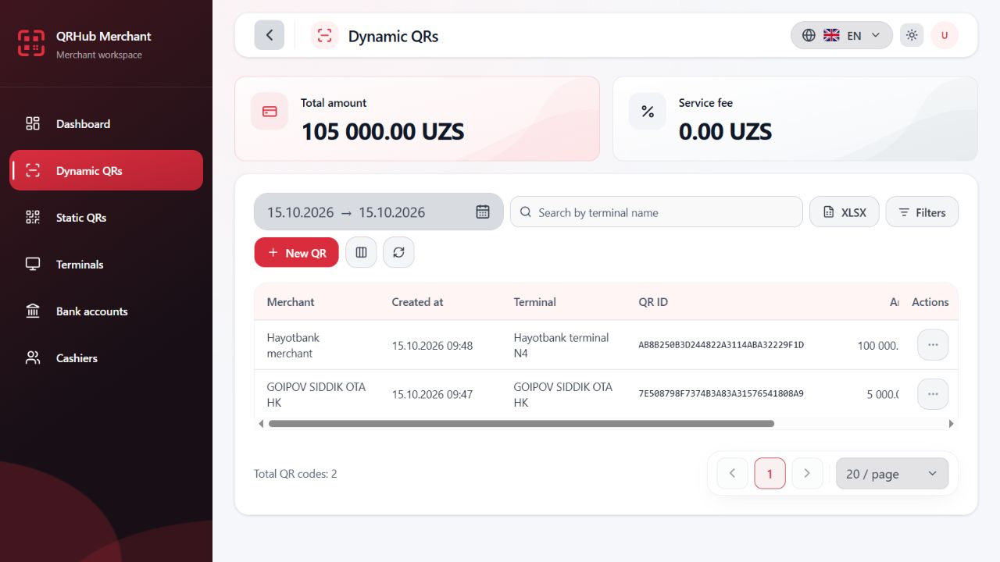
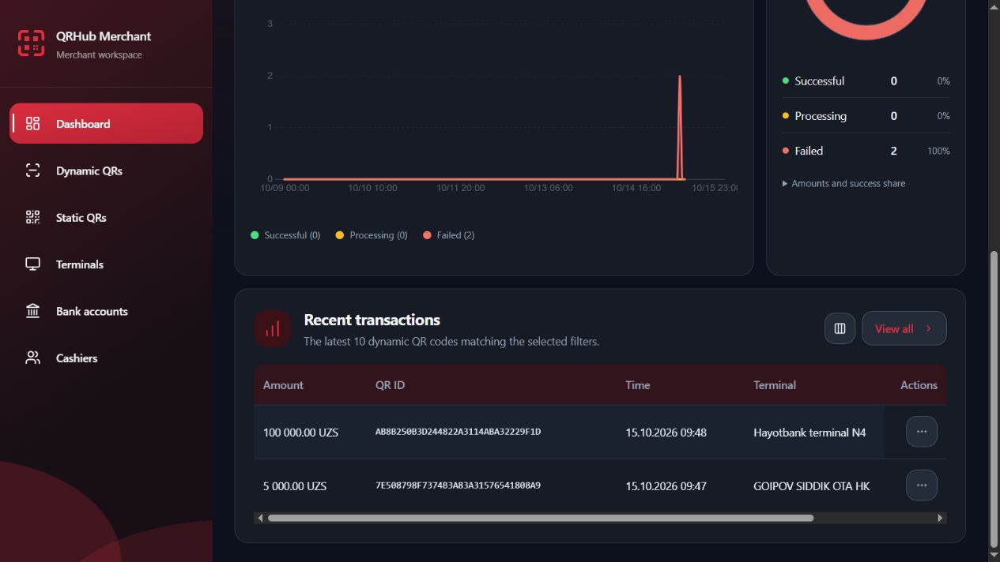

# UIX.TABLE_DATETIME.1 — Table date-time standardization

Status: COMPLETE. Verified 2026-10-15 in the existing local frontend workspace. This checkpoint changes presentation only and preserves all earlier uncommitted changes.

## Root cause and corrected output

The screenshot is the Dynamic QR `createdAt` column in `features/dynamic-qr/columns.tsx`. It calls the feature presentation adapter's `wallTime`, inherited from `createCalendarPresentation`.

The shared `formatOffsetlessDateTime` already produced `DD.MM.YYYY HH:mm`. However, `createCalendarPresentation.wallTime` used it only as validation, discarded its result and rebuilt the date through the locale-aware `date()` method. With the active English application locale explicitly registered as en-US, Intl.DateTimeFormat produced MM/DD/YYYY. The browser's default locale was not responsible. This pre-existing table policy was separate from the recently approved numeric date-range trigger.

| Backend value | Previous English table | Corrected table (uz/ru/en) |
| --- | --- | --- |
| 2026-10-15T09:48:00 | 10/15/2026 09:48 | 15.10.2026 09:48 |
| 2026-10-15T09:47:00 | 10/15/2026 09:47 | 15.10.2026 09:47 |
| 2026-01-02T03:04 | unchanged raw ISO carrier | 02.01.2026 03:04 |

## Formatter audit and implementation

- Reused `shared/presentation/date-time.ts::formatOffsetlessDateTime`; no competing date library or second formatter was added.
- `createCalendarPresentation.wallTime` now directly delegates to that existing formatter. This applies the approved numeric table/detail policy in all three supported locales.
- The formatter now accepts nullable/undefined input explicitly, preserving the existing `—` placeholder. Malformed nonempty input remains unchanged rather than becoming a fabricated date.
- Its existing lexical timestamp validation was extended to minute-precision carriers because the actual unchanged frontend `isoLocalDateTime` wire decoder already accepts `YYYY-MM-DDTHH:mm`. Optional seconds/fractions are validated when present and omitted from display. This is display compatibility, not a wire-parser change.
- The legacy development Dashboard preview's seven deterministic `createdAtLabel` fixtures now call the same formatter with their original date/time expressed as ISO local carriers. The table still receives presentation labels. Arbitrary text is not parsed or reformatted.
- No table markup, widths, CSS, translations, sorting or list controller was changed.

Repository audit found no date-fns usage or toLocaleDateString path for table timestamps. Table/date-detail paths use the shared calendar presentation adapter. Other Intl.DateTimeFormat calls are calendar/chart date labels, calendar weekday/day accessibility labels, Tashkent date presets and instant refresh metadata. toLocaleString calls format numbers/money, not table timestamps.

### Scope of DATE / DATE_TIME / TIME

- DATE_TIME: every actual backend timestamp table column uses `DD.MM.YYYY HH:mm`, including the Dashboard column labeled Time (its value is a full timestamp).
- DATE: the previously approved shared `formatDateRangeEndpoint` remains `DD.MM.YYYY`, with unchanged date-only carriers and query semantics. There are no separate production date-only table columns in this audit.
- TIME: timestamp display uses zero-padded 24-hour `HH:mm`. There are no standalone time-only table values requiring another formatter. Instant-based last-refresh metadata deliberately keeps its existing HH:mm:ss policy; it is not a table timestamp column.
- The general `date()`/`month()` presentation methods remain locale-aware for chart/calendar labels. This checkpoint does not silently replace every date label in the product.

## Timestamp and timezone contract

Frontend: `shared/contracts/merchant-read.ts::isoLocalDateTime` accepts timezone-free ISO local timestamps with minute precision, optional seconds and optional nanosecond-scale fraction. It validates date/time components, returns the original carrier, and rejects Z/explicit offsets/epoch/date-only values for this type. Required fields remain required; optional decoders retain their existing null fallback.

Backend inspected read-only at `D:/QR projects/qrhub-merchant-service`:

- Web `domain/custom/DynamicQrDTO.java` uses LocalDateTime for createdAt/updatedAt; P5DTO, StaticQrDTO, TerminalDTO and CashierDTO use the same wall-clock type where exposed.
- `repository/impl/TransactionQrsRepositoryImpl.java:39` explicitly documents created_at as a timezone-free Tashkent wall-clock timestamp, not UTC. Its dashboard zone is Asia/Tashkent.
- JDBC readers use LocalDateTime for these database columns; P5RepositoryImpl reads created_at as LocalDateTime and orders by the database created_at value.

The formatter validates/slices the original components. It never constructs a Date, appends Z or converts between zones. Thus 09:48 stays 09:48, midnight stays the same calendar date and end-of-year values do not shift. The unrelated UTC setting in calendar date-label formatting represents lexical calendar carriers; it was not applied to these timestamp values.

Z/offset timestamps are explicitly tested as unsupported by this wall-time formatter: the original string is preserved. No assumption that every timestamp is UTC or a Tashkent instant was introduced. A future zoned/epoch table contract would need its own explicitly authorized policy; it is not silently coerced through this local-time path.

## Coverage inventory

| Area | Actual table/date fields | Effect / evidence |
| --- | --- | --- |
| Dynamic QR | Table createdAt; details createdAt/updatedAt | Shared wallTime; live Created at cells verified; column and i18n tests |
| Dashboard | Recent transactions createdAt (Time); its Dynamic QR details | Same shared wallTime; second live table verified; Dashboard regressions |
| P5 | Table createdAt; details createdAt | Shared wallTime; real decoder/column tests in uz/ru/en; P5 i18n/details regressions |
| Static QR | No date column; details createdAt/updatedAt | Shared wallTime through existing dateValue helper; existing nullable placeholders retained |
| Terminals | No date column; details createdAt/updatedAt | Shared wallTime; existing optional guards/placeholders retained |
| Cashiers | No rendered date column or date detail field | Contract carries optional timestamps, but no display field was added |
| Bank accounts | No timestamp display field in current row contract/table | No artificial date column or contract change |
| Development Dashboard preview | Explicit createdAtLabel fixtures | Same formatter now generates the seven known sample labels |
| XLSX/PDF/export previews | No timestamp presentation path using wallTime | Server XLSX binary pass-through and QR poster/export behavior unchanged |

Business/free-text fields (terminal names, descriptions, IDs and search strings) are untouched even if they contain slash-formatted dates. A regression test keeps `raw 10/15/2026 text` intact.

## Sorting, filtering, pagination and exports

Production renderers format only at renderCell/detail presentation. They do not replace row.createdAt/updatedAt, page content or cache keys. New tests decode actual Dynamic QR/P5 responses and compare the complete page object before and after rendering every date column. Minute, second and fractional carriers remain byte-for-byte unchanged in the data model.

The backend Dynamic QR list still uses `ORDER BY tq.created_at DESC`; P5 still uses `ORDER BY p.created_at DESC`. No display-string comparator was added. The two live records retained their original 09:48, then 09:47 order. Table sorting/filtering/page state is independent of these display strings.

`toDynamicQrQuery` tests preserve original YYYY-MM-DD fromDate/toDate, search text, page=3 and size=100. Existing immediate-apply/date-picker/runtime, search contract and pagination regressions passed. Date-range trigger formatting is unchanged.

No XLSX download or backend mutation was executed during browser verification. Export request/money contracts, backend-generated workbook bytes and QR poster/PDF content paths were not edited. The full suite's existing export regressions passed; this checkpoint does not claim newly inspecting a live workbook.

## Browser observations — live read-only tables

Environment: Windows/PowerShell, Node v24.14.0, React 19, Vite 8.3.0, Vitest 5.0.0. Workspace `D:/QR projects/qrhub-merchant-frontend`, HEAD `cf8a0e508fb6ee305a226f28ca5fe46a51502df6` plus preserved prior working changes.

Existing local Vite listeners at 127.0.0.1:5173 and ::1:5173 were detected before navigation; no server was started. The real Codex In-app Browser used the existing authorized session and local/staging read integration at `http://127.0.0.1:5173/dynamic-qrs` and `/dashboard`. No mocks were used for these table observations.

- Dynamic QR English dark and light desktop: actual cells showed `15.10.2026 09:48` and `15.10.2026 09:47`; total remained 2 and page size 20. The date trigger remained `15.10.2026 → 15.10.2026`.
- English, Uzbek and Russian all showed the same numeric table dates. Labels remained translated through the existing locale system.
- At 390×844, the page had no horizontal document overflow. Timestamp column width stayed 156px. The existing horizontally scrolling table and sticky Actions column are preserved. At the initial scroll position the pinned action column obscures part of later columns; keyboard ArrowRight scrolling exposed both complete timestamps without changing column widths. This is existing responsive table behavior, not a newly expanded column.
- A focused/scrolled Uzbek light mobile screenshot shows both complete timestamps; Russian light mobile and English light mobile screenshots were also captured.
- Dashboard English dark: the actual recent-transactions Time cells showed the same two standardized timestamps, in the original order. The column width remained 164px.
- Language/theme were restored to English/dark and the viewport override reset.

Physical mobile/touch/software keyboard was not tested. P5 lacked an authorized navigation entry in this browser session; its actual shared column/decoder rendering was verified by tests, not a live P5 request. Static/Terminal detail propagation is supported by source and existing i18n/details regressions rather than an additional live screenshot in this checkpoint.

## Verification results

- Focused: **224 passed / 17 files**. Includes shared date-time/calendar presentation, all three timestamp column factories, Dynamic QR table/i18n, Dashboard i18n/date runtime, P5, Static QR, Terminal and search/filter regressions.
- Full frontend suite: **2,297 passed / 242 files** (`npm test -- --maxWorkers=2`).
- New cases cover the screenshot examples, single-digit calendar components with zero padding, minute-only carriers, midnight/end-of-day, leap days, month/year boundaries, fractions, null/empty, invalid dates/times, explicit Z/offset/epoch exclusions and deterministic output under Honolulu/Tashkent/Kiritimati host timezone settings.
- Typecheck: PASS (`npm run typecheck`).
- Lint: PASS; only existing Button/Badge Fast Refresh export warnings.
- Production build: PASS (`npm run build`, Vite 8.3.0); existing large-chunk advisory remains.
- `git diff --check`: PASS (Git's existing LF→CRLF notices only).

## Exact files changed by this checkpoint

Previous uncommitted work is preserved. Shared calendar and Dashboard i18n tests also contain earlier checkpoint edits.

```text
src/shared/presentation/calendar.ts
src/shared/presentation/date-time.ts
src/shared/presentation/date-time.test.ts
src/shared/presentation/table-date-time.test.tsx
src/features/dashboard/dashboard.i18n.test.tsx
src/dev/dashboard.fixture.ts
docs/audits/UIX_TABLE_DATETIME_STANDARDIZATION.md
```

New evidence files (before image is the supplied user reference):

```text
docs/audits/evidence/UIX_TABLE_DATETIME/before-user-reference.png
docs/audits/evidence/UIX_TABLE_DATETIME/dashboard-en-dark-desktop.jpg
docs/audits/evidence/UIX_TABLE_DATETIME/dynamic-en-dark-desktop.jpg
docs/audits/evidence/UIX_TABLE_DATETIME/dynamic-en-light-390.jpg
docs/audits/evidence/UIX_TABLE_DATETIME/dynamic-en-light-desktop.jpg
docs/audits/evidence/UIX_TABLE_DATETIME/dynamic-ru-light-390.jpg
docs/audits/evidence/UIX_TABLE_DATETIME/dynamic-uz-light-390-scrolled.jpg
```





## Final checkpoint

CHECKPOINT: UIX.TABLE_DATETIME.1

STATUS: COMPLETE

ROOT_CAUSE: Active en-US application locale re-formatted validated wall-clock dates through Intl; shared wallTime discarded the existing numeric formatter output.

CREATED_AT_FORMAT: PASS

DATE_TIME_FORMAT: DD.MM.YYYY HH:mm

CENTRAL_FORMATTER: REUSED

TIMEZONE_PRESERVED: YES

SORT_FILTER_PRESERVED: YES

TABLE_COVERAGE: Dynamic QR, Dashboard recent transactions, P5 timestamp columns; Dynamic QR/Static QR/Terminal/P5 details via shared formatter; other audited tables have no date columns; development Dashboard preview standardized.

I18N: PASS

BROWSER_VERIFICATION: PASS (live Dynamic QR and Dashboard; uz/ru/en, themes, mobile viewport evidence)

TYPECHECK: PASS

LINT: PASS

FULL_TEST_SUITE: 2297 passed / 242 files

BUILD: PASS

BACKEND_CHANGED: NO

STAGING_DEPLOYED: NO

FILES_CHANGED: Exact paths listed above, including evidence files.

NEXT_STEP: Review standardized table formatting.
