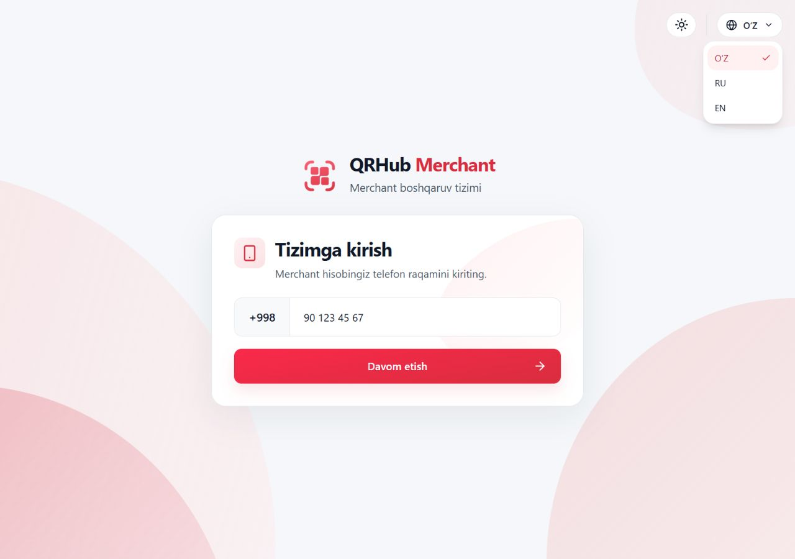
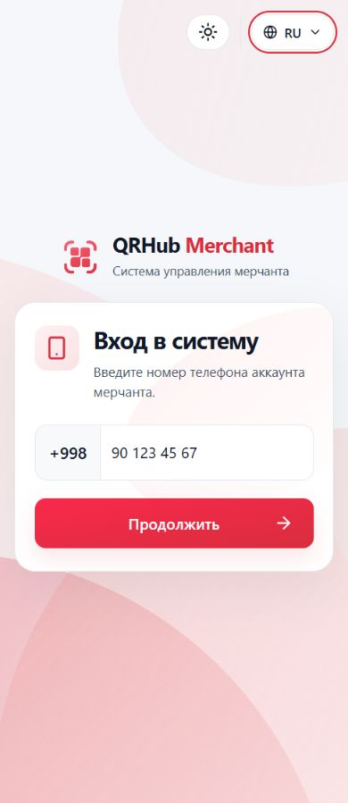
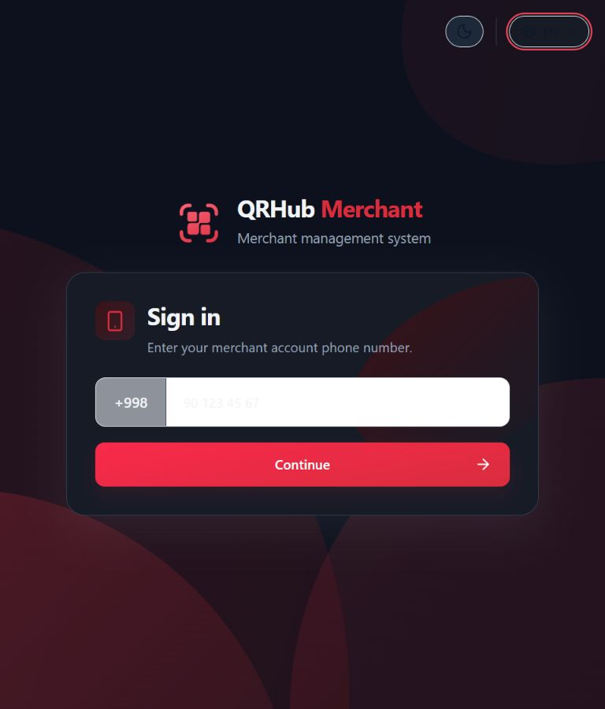
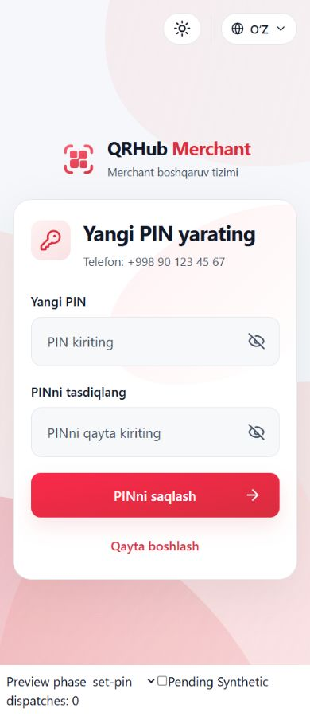

# UIX.LOGIN.HEADER_CONTROLS

Date: 2026-10-12 (Asia/Tashkent). Status: COMPLETE. Implementation, browser verification, and required checks are complete.

## Git baseline and preserved workspace

Branch: `feature/dashboard-analytics`.
HEAD: `372430ae4380b0f25cb9f8491b4e679db267420b`.
Workspace: `D:/QR projects/qrhub-merchant-frontend`.

Initial `git status --short`:

```text
 M src/features/dashboard/DashboardReadPage.test.tsx
 M src/features/static-qr/StaticQrPage.test.tsx
 M src/features/static-qr/StaticQrPage.tsx
 M src/locales/en/dashboard.json
 M src/locales/ru/dashboard.json
 M src/locales/uz/dashboard.json
 M src/shared/ui/TableColumnPreferences.tsx
?? src/features/static-qr/column-trigger.test.tsx
```

All eight initial dirty paths were preserved. No reset, stash, discard, commit, dependency update, route change, or backend change was performed.

## Reference images

Both attached images were inspected before implementation:

- Target: `C:/Users/Asus/AppData/Local/Temp/codex-clipboard-2c82ebea-9786-4e27-a27d-21c0a7795537.png`. Theme icon, vertical divider, then locale selector in the top-right corner.
- Previous layout: `C:/Users/Asus/AppData/Local/Temp/codex-clipboard-3b682026-50bc-4a69-ae34-053c45447d85.png`. Locale selector between branding and login card.

The reference controls were used to guide placement and appearance. Existing branding, card width, internal spacing, backgrounds, input masks, headings, and authentication behavior were retained.

## Changed files

- `src/features/auth/AuthPresentation.tsx`: move the single existing `LocaleSelect` into a shell-level control group; compose `ThemeModeSelect compact` before an aria-hidden divider.
- `src/features/auth/auth.css`: scoped control styling and responsive, safe-area-aware shell padding.
- `src/features/auth/LoginForm.test.tsx`: supply the existing real ThemeProvider to the existing server-rendered AuthShell fixture. Existing assertions remain intact.
- `src/features/auth/header-controls.test.tsx`: ten new tests using real theme/locale providers, actual forms, QueryClient, and a LoginController with deferred synthetic API responses.
- `docs/i18n/UIX_LOGIN_HEADER_CONTROLS_REPORT.md`: this report.
- `docs/i18n/login-header-evidence/1280-uz-light.jpg`.
- `docs/i18n/login-header-evidence/390-ru-dark.jpg`.
- `docs/i18n/login-header-evidence/768-en-system.jpg`.
- `docs/i18n/login-header-evidence/390-ru-set-pin.jpg`.
- `docs/i18n/login-header-evidence/browser-measurements.json`.
- `docs/i18n/login-header-evidence/auth-stage-measurements.json`.

## Layout and reused infrastructure

AuthShell renders the controls once before its centered composition. The theme control is 48 by 40 CSS pixels; the locale pill is 40 pixels high. A 1-pixel-wide, 36-pixel-high decorative divider separates them. Desktop offsets are 20 pixels; mobile offsets are 16 pixels, increased when safe-area insets require it. The group remains horizontal.

The controls are positioned within the relative shell. Reserved top and bottom padding of at least 88 pixels keeps absolute controls clear of the content, including long mobile auth stages. On sufficiently tall screens, symmetric padding retains centered composition alignment. Smaller/shorter screens can scroll vertically as content requires. The centered selector and its intervening layout row were removed. Card sizing, card padding, typography, logo, and background-shape rules were not changed.

ThemeModeSelect retains the existing Light -> Dark -> System -> Light cycle, icons, guarded accessible messages, immediate ThemeProvider reconciliation, `qrhub:theme:v1` persistence, and OS preference subscription. No theme state or provider was added to production. Theme styling is scoped to AuthShell; the authenticated Header and shared ThemeModeSelect implementation are unchanged.

LocaleSelect retains its implementation, guarded messages, native language names, abbreviations, selected checkmark, red accent, collision-aware dropdown, focus restoration, `switchLocale`, and `qrhub:locale:v1` persistence. No catalogs, translation keys, or locale infrastructure were modified.

## Auth flow and state preservation

LoginForm, login controllers, auth/session providers, token/device-lease handling, DTOs, APIs, and routes are unchanged. No locale/theme key was added to remount either the shell or form.

New mounted tests cover phone, OTP, reset OTP, existing PIN, and both new-PIN fields. They verify input/form identities and drafts, countdown, independent locale/theme persistence, stable QueryClient cache, and zero form-action dispatches while operating header controls. A real LoginController test verifies one pending create-session/send-OTP operation, unchanged request signal/snapshot, one acquired device lease, no release/session establishment, and the same eventual OTP deadline. System preference changes are exercised through the existing media-query subscription. A fresh provider mount restores independently persisted selections.

Existing auth integration/controller tests remain part of the full suite. Browser recovery-stage checks include blocked, expired, and error screens.

## Browser verification and screenshots

Actual localhost `/login` was reviewed in the Codex in-app browser. [Measurements](login-header-evidence/browser-measurements.json) record 27 configurations: 390, 768, and 1280 CSS pixels wide, each with UZ/RU/EN and Light/Dark/System. All configurations had exactly one locale selector, no selector inside the centered composition, correct control order, controls above branding, no horizontal overflow, and dropdown bounds within the viewport. Escape closed the dropdown. Reload restored EN and System selections. Phone input values are redacted by browser tooling; exact draft retention is independently established by the mounted tests.

A temporary local preview rendered the actual AuthShell and LoginForm with synthetic snapshots, not staging authentication. [Stage measurements](login-header-evidence/auth-stage-measurements.json) cover 16 mobile samples: eight auth/recovery stages in Russian and English. There was no control/content overlap or document horizontal overflow. Keyboard Enter operated the theme button, Tab reached the language selector, and pending form inputs remained disabled while controls stayed usable. The preview's auth dispatch counter remained zero. The temporary HTML/TSX files, development server, viewport override, and agent-created browser tab were removed/closed after review.









## Verification commands

| Command | Result |
| --- | --- |
| `npm run locales:validate` | PASS |
| `npm run lint` | PASS; inherited Fast Refresh warnings in button.tsx and badge.tsx only after preview cleanup |
| `npm run typecheck` | PASS |
| `npx vitest run src/features/auth src/shared/theme src/shared/i18n` | PASS: 188 tests across 14 files |
| `npm test` | PASS with default workers: 2147 tests across 230 files |
| `npm run build` | PASS; existing large-chunk advisory |
| `git diff --check` | PASS |

An initial new-test run failed seven cases because the test helper used a synthetic click to open the Radix locale menu. The helper now uses the established keyboard-opening fixture behavior; all ten new tests pass without weakening assertions. The first large browser matrix exceeded the tool execution limit; all 27 configurations were subsequently completed in smaller batches and saved. Preview-only Fast Refresh/purity warnings and a createRoot hot-reload warning occurred while editing the disposable harness; the harness was removed and final lint has only the two inherited shared-UI warnings.

Final workspace status (the evidence directory contains the six files listed above):

```text
 M src/features/auth/AuthPresentation.tsx
 M src/features/auth/LoginForm.test.tsx
 M src/features/auth/auth.css
 M src/features/dashboard/DashboardReadPage.test.tsx
 M src/features/static-qr/StaticQrPage.test.tsx
 M src/features/static-qr/StaticQrPage.tsx
 M src/locales/en/dashboard.json
 M src/locales/ru/dashboard.json
 M src/locales/uz/dashboard.json
 M src/shared/ui/TableColumnPreferences.tsx
?? docs/i18n/UIX_LOGIN_HEADER_CONTROLS_REPORT.md
?? docs/i18n/login-header-evidence/
?? src/features/auth/header-controls.test.tsx
?? src/features/static-qr/column-trigger.test.tsx
```

## Limitations

No staging backend authentication E2E, real OTP/PIN submission, actual mobile software keyboard, screen-reader audit, or physical device safe-area simulation was performed. Browser auth stages use synthetic snapshots; real pending command/lease/countdown preservation and OS preference change handling are verified by automated tests. Existing platform theme and language policies are preserved.
